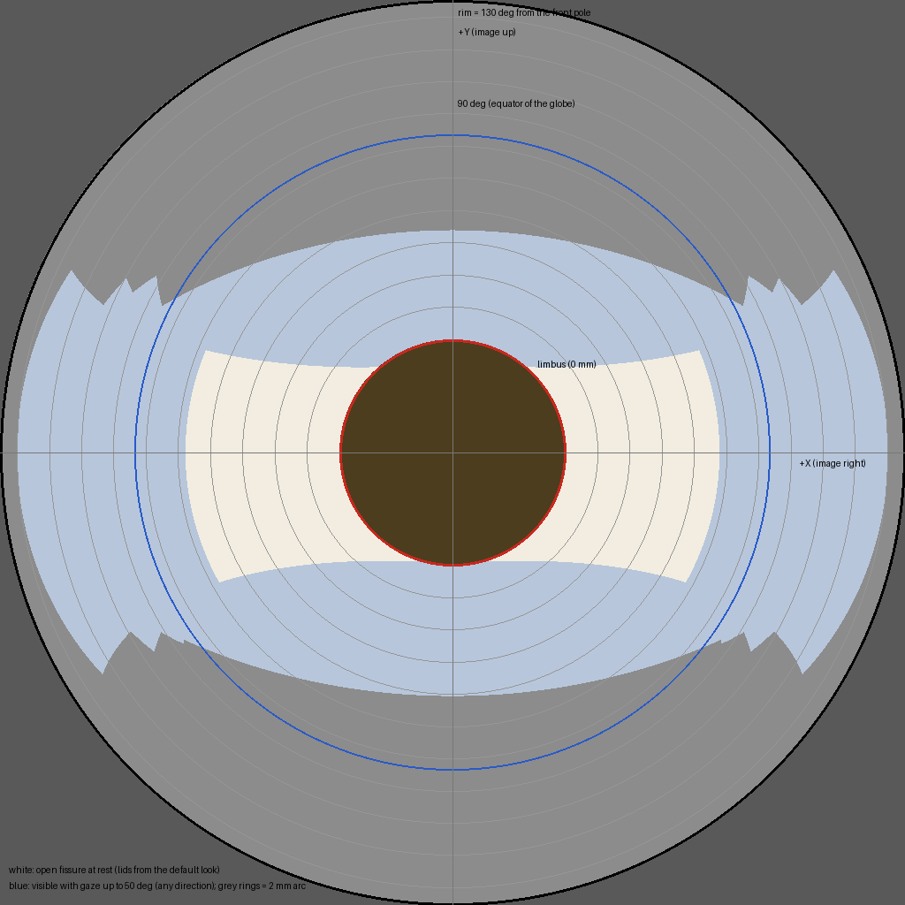
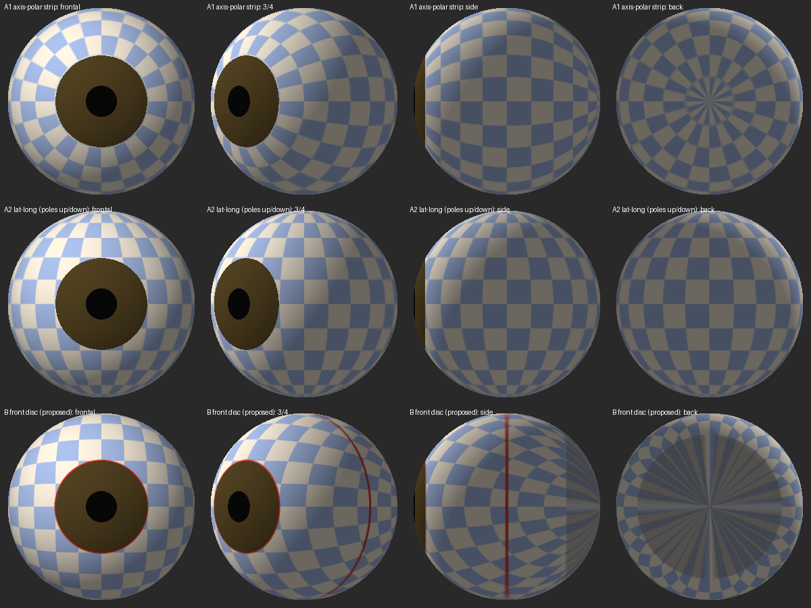
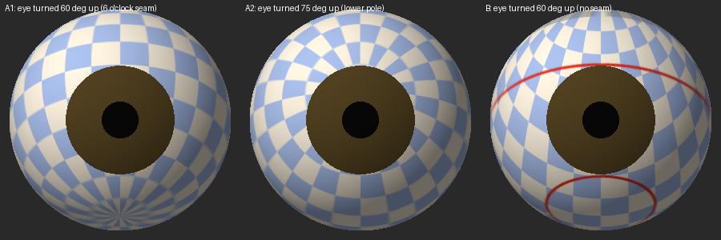
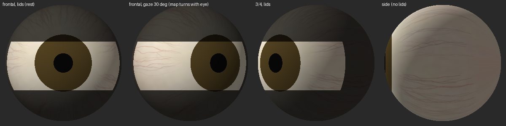
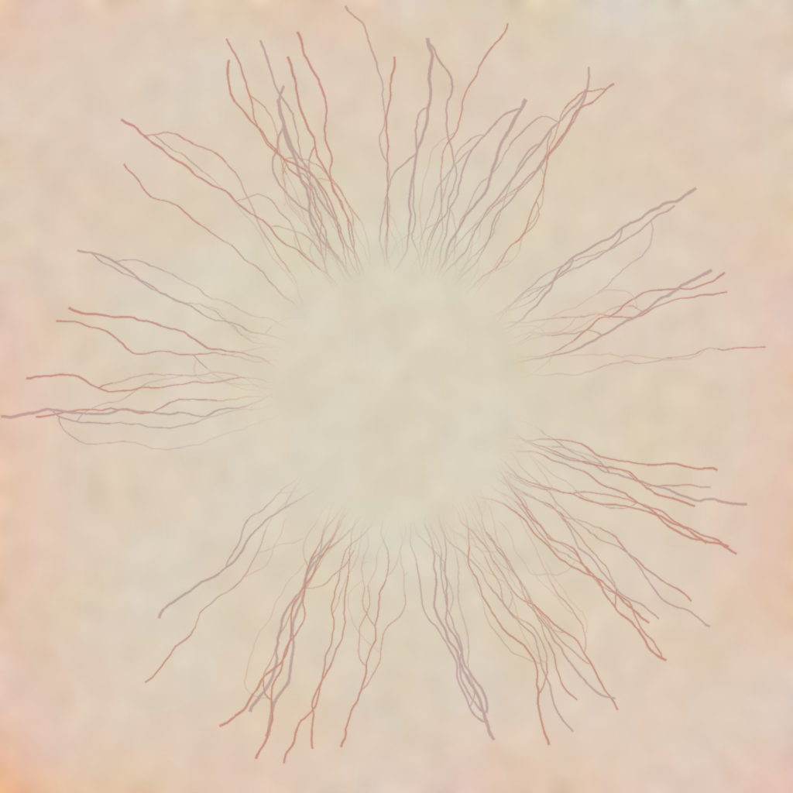

# Eye LookDev: the sclera surface — research and architecture audit (AD-035 research)

**Status:** Discovery (2026-11-17, English with a German summary): research and architecture assessment, **no
decision, no code change, nothing committed**. Every implementation step in §9 needs Manu's go; the decisions in §10
are Manu's and are not made here.
**Baseline:** `main` @ `e22f22f` (verified: the working branch was identical to `origin/main`; latest eye commit
`05cdee8` "phase 5 - the iris import in the Eye Lab").
**Sources:** [AD-033](../architecture/AD-033-EYE-PREVIEW-IN-THE-WORKLIGHT.md) (§4–§19),
[phase 2 assessment](EYE_LOOKDEV_PHASE2_ASSESSMENT_2026-11-16.md), [REFERENCE_HARDWARE](../architecture/REFERENCE_HARDWARE.md),
the eye results files in `experiments/drag_cost/`, and the code under `src/viewport/eye_*.py`, `src/mirai/eye_*.py`,
`src/mirai/iris_import.py`, `src/mirai/texture_files.py`, `src/mirai/application.py`, `src/mirai/controllers/objects.py`,
`src/core/scene.py`, `src/core/serialization.py`, `src/gui/eye_*.py`.
**Figures:** `eye_sclera_assets_2026-11-17/` (generated by `sclera_mapping_study.py` in that folder; NumPy + PIL,
research only, reproducible with `python docs/research/eye_sclera_assets_2026-11-17/sclera_mapping_study.py <out dir>`).

Evidence labels: **[V]** verified in code or by a read-only run today · **[RPC]** measured on the reference PC (results
files in the repo) · **[C]** computed today in this container (geometry / NumPy, not a hardware number) · **[E]**
estimate · **[R]** research finding (anatomy, authoring practice, GL behaviour) · **[P]** agent recommendation ·
**[M]** a decision that belongs to Manu.

## Kurzfassung für Manu (Deutsch)

- **Machbar ohne Umbau.** Die Lederhaut-Farbe geht heute an genau **zwei** Stellen in den Shader (Lederhaut-Dreiecke
  und das Limbus-Gewebe, das man durch die Hornhaut sieht). Eine Farbtextur ersetzt dort nur die eine Farbe; nasser
  Film, Spiegelungen, Unregelmäßigkeit, Lidschatten und Lidband rechnen unabhängig davon weiter und bleiben unverändert.
- **Abbildung (Empfehlung): „Frontscheibe“.** Das Bild ist das Auge **von vorn gesehen** — wie beim Iris-Bild: Mitte =
  Hornhautmitte, rechts = +X, oben = +Y. Der Limbus liegt immer auf einem festen Kreis (¼ der halben Bildbreite), der
  Bildrand ist 130° von der Hornhautmitte entfernt (alles, was mit Lidern und bis 50° Blick je sichtbar wird, liegt
  innen: gemessen max. 125°). **Keine Naht** im sichtbaren Bereich; der einzige Singularpunkt liegt hinten am Sehnerv.
  Das ist auch die übliche Form gemalter Augen-Texturen; Adern malt man vom Rand zur Mitte. Die Alternative
  „Weltkarte“ (lat-long) ist gleichmäßiger, aber hat Pole oben/unten und passt schlechter zu Fotos und Iris-Workflow.
- **Inhalt:** ein **vollständiges RGB-Farbbild** (Grundton, rosa/gelb/grau Variation, feine Adern). Kein Alpha, keine
  Normal- oder Rauheitskarte in Schritt 1: die Adern liegen in der Bindehaut flach, die Nässe macht schon der Shader.
- **Daten (Vorschlag, deine Entscheidung):** ein eigenes Feld `EyeSpec.sclera_texture` (Pfad oder leer), **nicht**
  `SceneObject.texture` (das bleibt das Iris-Bild). Undo, Duplizieren, Spiegeln, Morph-Zwillinge funktionieren damit
  automatisch; Szenenformat v12 (nur geschrieben, wenn ein Auge ein Lederhaut-Bild hat); „Speichern unter“ kopiert das
  Bild wie das Iris-Bild nach `<Szene>_textures/`; Vorlagen lassen es in Ruhe.
- **Befund, der dich schon heute betrifft:** Im Eye Lab ist das gewählte Auge immer ausgewählt — und bekommt deshalb
  den gelben Auswahl-Schimmer auf die Lederhaut. Nachgemessen: Basisfarbe (0,86 / 0,83 / 0,79) wird als
  (0,92 / 0,83 / 0,50) gezeichnet. Für Lederhaut-Lookdev muss das weg (Vorschlag: im Eye Lab keine Auswahlfarbe auf
  Augen).
- **Links/rechts:** Ein gespiegeltes Auge bekommt beim Spiegeln eine echte Drehung, keine Spiegelung — dasselbe Bild
  erscheint auf beiden Augen gleich herum (nasal links wird beim anderen Auge temporal). Vorschlag: pro Auge ein
  eigenes Bild; ein „Bild spiegeln“-Schalter pro Auge erst, wenn du ihn brauchst.
- **Kosten:** ein Texturzugriff pro Augenpixel. Messanker auf deinem PC: ein Zugriff über ein ganzes 1920×1080-Bild
  ≈ 0,1 ms. Schätzung im Eye-Lab-Blick deutlich unter 0,1 ms, Ziel 0,2 ms realistisch — **noch zu messen**. Ohne
  Lederhaut-Bild bleibt das Shader-Programm Zeichen für Zeichen das heutige.
- **Kleinster sicherer erster Schritt (M1):** Lederhaut-Bild laden / ersetzen / entfernen im Eye Lab, Frontscheibe,
  RGB, beide Qualitätsstufen, ein Undo-Schritt, Speichern relativ zur Szene. Dazu eine Malvorlage und eine erzeugte
  Test-Textur (keine Fotos im Repository). Foto-Import mit Entzerrung (wie beim Iris-Import) erst als M2.

---

## 1. The current production implementation in one page

- **The eye is a scene object** whose `SceneObject.eye` holds a frozen `core.EyeSpec` (anatomy, iris fit, limbus,
  optional `EyeLook` with optional `EyeIris`) [V] (`src/core/scene.py:286`). Its mesh is a generated shell, never
  edited by hand: corneal cap first, then the sclera sphere (radius 1, eye-local, looking down +Z) from the limbus ring
  to a back-pole fan [V] (`src/mirai/eye_object.py:121`). One scene unit = 1 cm; the object scale 1.2 makes the sclera
  radius 12 mm [V].
- **The eye pass** (`src/viewport/eye_pass.py`) draws the shell's VertexList with its own program; the Worklight is
  untouched [V]. Every visual feature is a `#define` variant; without the feature the source is character for
  character the earlier program (pinned in `tests/test_gl_eye_pass.py`) [V].
- **The sclera today:** a single colour — the object's material base colour (new eye: the lab's sRGB
  (0.86, 0.83, 0.79), `eye_object.py:29`) — lit by the Worklight's own wrap diffuse, with the Worklight's Blinn–Phong
  highlight, or (phase 3, "full" tier) the wet film: GGX key / soft key + analytic studio, film irregularity from a
  noise texture, lid shadow and lid band in the rest frame [V]. P1c's limbus band blends the limbal colour into it [V].
- **The iris image** is `SceneObject.texture` (AD-026's path), loaded through the shared `GLRenderStore.texture` cache
  (mipmapped, REPEAT, linear) and bound to unit 1; phase 5 imports photos/paintings into a scene-relative copy in
  `<scene>_textures/` [V].

## 2. Audit: architecture boundaries and code paths

### 2.1 Shell geometry

`shell_mesh` builds 64 segments × (16 cornea + 36 sclera) rings; the sclera rings run from θ_L = asin(limbus_radius)
(29.3° for the default 0.49) to just before the back pole, then a pole fan at (0, 0, −1) [V]. The limbus ring's
vertices are shared by cornea and sclera, and the cornea's triangles come first, so the fragment shader tells cornea
from sclera **per triangle** with `gl_PrimitiveID < u_cornea_triangles` (`eye_shaders.py:663`) [V]. Consequence for a
texture: implicit derivatives (`texture()` mip selection) are well defined in both branches, as long as the sample is
taken outside any per-pixel branch (the L3 fast path at `eye_shaders.py:792` is per pixel — sample before it) [V].

### 2.2 Eye-local positions and normals

The vertex shader passes only the world position; the fragment shader brings it back to eye-local space with
`u_model_inv` (`eye_shaders.py:659`): `p` is the eye-local surface point, `normalize(p)` the sclera normal, the camera
ray is traced eye-locally, and normals go back to world with `mat3(u_model)` for the Worklight light [V]. **Every
sclera point therefore already has a stable eye-local position** — the natural input for an analytic texture mapping,
independent of the mesh's tessellation and with no UVs needed. The phase 3 film noise already uses such a mapping:
`film_uv` (`eye_shaders.py:338`) is an azimuthal equidistant projection about +Z (`p.xy · θ/ρ`) [V].

### 2.3 `sclera_u`, `cornea_u`, `normal_blend` and the limbus transition

- `sclera_u(p) = atan(|p.xy|, p.z) − θ_L` — the arc angle beyond the limbus on the sclera; `cornea_u(p) = |p.xy| − r_L`
  — negative on the cornea (`eye_shaders.py:288`) [V]. Both are 0 on the ring, so the two branches meet continuously.
- `colour_weight(u)` / `limbus_tint` (L1+) blend the limbal colour into the sclera colour over the band from `u_u0`
  (the chamber angle's radius minus the ring's, i.e. **inside** the cornea) to `band_mm` beyond it; `asym_shift` /
  `iris_cover` add the overlap and the top/bottom asymmetry [V].
- `normal_blend` (L2+) mixes the cornea normal into the sclera normal over ±`normal_mm` about the ring [V].
- L3 lets the iris show through the translucent band (`transmission`, `sclera_through`) [V].

**Consequence:** the sclera colour is visible *inside* the limbus ring too (the limbal tissue seen through the
peripheral cornea), so a sclera map must be defined a little inside the ring and sampled there with the same mapping
as on the sclera, or a colour step appears at the ring [V].

### 2.4 Where the sclera albedo enters the shader — two places

| Branch | Line | What |
|---|---|---|
| cornea (`KIND_LIMBUS` tissue, and the cover over the iris) | `eye_shaders.py:722` (L1+) / `:724` (L0) | `tissue = lit(limbus_tint(colour_weight(us), u_limbus_albedo, u_sclera_albedo), ns)` at the cornea entry point |
| sclera | `eye_shaders.py:803` (L1+) / `:805` (L0) | `albedo = limbus_tint(…, u_sclera_albedo)` (L0: `u_sclera_albedo`) |

Both read the one uniform `u_sclera_albedo`, which the app resolves on the CPU **including the selection tint**
(`objects.py:1269`: `selected_color(...)` when highlighted, else the material base colour) [V]. No other term reads the
albedo: the Blinn–Phong highlight, the wet film reflection, the lid band and the L3 transmission are added or mixed
*after* `lit(albedo, n)` and do not depend on it [V] (§2.5). **A colour map therefore needs to replace exactly these
two reads with one function `sclera_albedo(point)`** — nothing else in the shader changes.

### 2.5 Wet film, reflection normal, roughness, lid effects

In the sclera branch (`eye_shaders.py:815–850`) [V]:
`colour = lit(albedo, n)` → L3 transmission mix → `colour *= 1 − lid_shadow·w(p_rest)` → with `u_wet > 0`:
`colour = (1 − wet·F)·colour + (1 − wet)·highlight + wet·display_add(film_reflection(n_film, …))`, where `n_film` is
the normal tilted by the noise texture (`film_sample(p)`, eye-local) and the roughness comes from `sclera_roughness` and
the noise's third channel; the lid band dims the reflection. **None of these terms read the albedo**; the reflection
is computed in linear light and *added*. A painted map changes only what the light falls on — the corneal and scleral
reflections stay visually separate from the painted detail by construction [V].

### 2.6 Gaze: drawn transform vs. stable eye surface

The gaze is view state; `ObjectController._drawn_matrix(obj, gaze, …)` turns the drawn model matrix about the sclera
centre by the shortest rotation (Listing's law, no added roll; at most 50°, `eye_gaze.MAX_GAZE_DEGREES`) [V]. Because
`p` is computed with the *drawn* `u_model_inv`, anything mapped from `p` turns with the eyeball — correct for the
sclera and the bulbar conjunctiva, which move with the globe [R]. The lids (shadow, band) use `u_rest`, the rest frame
without the gaze (`eye_pass.rest_rotation`) [V], so they stay with the head. Texture stability under gaze and orbit is
therefore automatic for any eye-local mapping; the synthetic renders (Fig. 3) show it.

### 2.7 How the iris texture is assigned and loaded

`EyeDraw.texture` = `obj.texture` (`objects.py:1280`); `EyePass.draw` loads it with `GLRenderStore.texture(path)`
(`eye_pass.py:418`): a class-wide cache keyed by (path, mtime, size), `load_texture` = pyglet decode → GL texture
(internal format from the image, no sRGB decode), `glGenerateMipmap`, `LINEAR_MIPMAP_LINEAR`, **REPEAT** wrap
(`gl_render_store.py:480`) [V]. A missing or unreadable file returns None and the eye falls back to the procedural iris
[V]. Texture units in use while an eye draws: 1 iris, 2 noise, 3 key table; the reference PC has 32 fragment units
[V][RPC]. The values are display-referred like every albedo in the eye pass (no linearisation) [V] — a sclera map's
pixel values would be "the surface colour as it should read under neutral Worklight light".

### 2.8 `SceneObject.texture`, `EyeSpec`, serialization, Undo, texture copies, presets

- `SceneObject.texture: str | None` is AD-026's per-object texture; for an eye it **is** the iris image (AD-033 §4.1,
  "no second path") [V]. The Worklight shows it on ordinary objects, the ZBrush bridge and OBJ import write it. Reusing
  it for the sclera is ruled out by the task and would break all of these meanings.
- `EyeSpec` is frozen, validated, serialized as `"eye": {…}` with the optional nested `"look"` / `"look.iris"`; a field
  missing from the file is a hard error except `look` (`EyeSpec.from_dict`) [V]. Format version is "by content": v9 eye,
  v10 look, v11 iris values (`serialization.py:109`) [V].
- **Paths:** the Core stores `texture` as a plain string; `mirai.texture_files` decides its meaning: on load a relative
  path is resolved against the scene directory (`application.py:717`, **only `obj.texture`**), on save a path inside
  the scene directory is written relative (`application.py:1376–1378`) [V].
- **Copies beside the scene** (phase 5, I-9): `_copy_iris_images` copies every *eye's* `obj.texture` that is not yet in
  `<stem>_textures/` byte for byte under its content name, then repoints the object without an Undo step
  (`application.py:1399`) [V].
- **Undo:** an image change is `ObjectTextureCommand` (path before/after), composed with `ObjectEyeCommand` for the fit
  in `apply_iris_image` → one step [V]. Any `EyeSpec` change through `set_eye` is one `ObjectEyeCommand` step [V].
- **Presets:** `PRESET_FIELDS` is derived automatically from `fields(EyeSpec)` minus `IMAGE_FIELDS`
  (`eye_presets.py:37–38`) [V]. **A new `EyeSpec` field is a preset field unless it is added to `IMAGE_FIELDS`** — a
  sclera path there would be written into preset files (absolute paths) and applying a preset would swap the image.
- **Duplicate, mirror copy, `replace_scene`, morph-view twins** all copy `obj.eye` (the spec) [V]; duplicate and
  `replace_scene` also copy `obj.texture` explicitly [V].

### 2.9 Findings that matter for the sclera

| # | Finding | Evidence | Consequence |
|---|---|---|---|
| F-1 | **In the Eye Lab the edited eye's sclera is drawn with the selection tint.** The Eye Lab needs a selected eye (mode 4), and a highlighted eye's `u_sclera_albedo` is `selected_color` (45 % toward (1, 0.82, 0.15)). | [V] read-only run today: material (0.86, 0.83, 0.79) → drawn **(0.923, 0.825, 0.502)** with the Eye Lab open | Sclera colour cannot be judged on the eye being edited — today already, and fatal for a colour map. Needs a rule (§10 S-4). |
| F-2 | Two albedo reads (sclera, limbal tissue through the cornea). | [V] §2.4 | Both must use the same mapping, or a step appears at the ring. |
| F-3 | Preset fields are derived from `EyeSpec`. | [V] §2.8 | A sclera path in `EyeSpec` must join `IMAGE_FIELDS`. |
| F-4 | Path resolution and Save-As copies handle only `obj.texture`. | [V] | Must be extended for a second image (one helper for "an eye's images"). |
| F-5 | A mirror copy's frame is a proper rotation (`R' = H R H`), not a reflection; the fresh shell is not mirrored. | [V] `object_mirror.py:64`, `objects.py:717` | The copy's eye-local +X is the mirror image of the source's **−X**: the same image appears *un*-mirrored in world space on both eyes (nasal on one = temporal on the other). §3.5. |
| F-6 | Gollum_Head_03 has two eyes in a mirror pair (yaw ±3.8°), both on one iris image, default base colour, with a look. | [V] scene file | The first real test case; one shared sclera image would show F-5. |
| F-7 | The shared texture cache sets REPEAT wrap on the texture object. | [V] | A disc mapping clamps its radius in the shader; a GL 3.3 sampler object (core since 3.3) can give CLAMP without touching the shared texture. |

No finding blocks the preferred direction (a standalone colour map with an eye-local mapping and the wet film left
intact). F-1 must be decided before a practical colour test is meaningful.

## 3. Texture mapping — the central question

### 3.1 The visible sclera region

Computed on the unit eye with the default look's lid heights (`lid_upper` 0.37, `lid_lower` −0.47, rest frame) and an
**assumed** horizontal fissure up to 75° from the front pole [E] (Gollum's fissure is wide; the canthi are not
modelled in Mirai):

- at rest the open fissure covers θ ≤ 75° horizontally and only about −28° … +22° vertically: a wide, flat band
  [C];
- with the gaze anywhere up to the 50° cap, points up to **θ = 125°** from the front pole become visible, on 43 % of
  the sphere [C];
- the back (θ > 125°, around the optic nerve) is never visible with lids; it is visible only in the isolated Eye Lab
  orbit (eyes without the head) [V].



*Fig. 1 — The proposed front-disc layout (1024²), usable as a painting template [C]. Red: limbus; blue: θ = 90° (the
globe's equator); black: the rim at 130°; grey rings every 2 mm of arc. White: open fissure at rest; blue-grey: what
any gaze up to 50° reveals. Image right = eye-local +X, up = +Y, as for the iris image.*

### 3.2 The candidates

**A1 — axis-polar equirectangular ("strip")**: u = azimuth φ about the eye axis, v = θ from the front pole. The image
is a strip: the limbus is one row, the posterior pole another.
**A2 — latitude/longitude ("world map")**: poles at eye-local ±Y (top/bottom of the globe), the cornea at the image
centre, the seam behind.
**B — front disc (proposed)**: an azimuthal projection about the eye axis — the image is the eye seen from the front.
Radius in the image (share of half the width) is a piecewise-linear function of θ with two knots: the limbus at a
fixed `R_L` = 0.25 and the rim at θ_rim = 130° (equidistant in arc between them; inside the ring linear down to the
centre). Because the knot follows `θ_L`, the limbus stays on the painted circle when the anatomy's limbus radius
changes — the same idea as the iris fit's pinned landmarks.
**C — cube map / octahedral** was considered: GL has native cube maps, and the reference PC measured them, but seamless
filtering fails at the cube corners on this driver (seams in the 4²–1² levels, REFERENCE_HARDWARE §2) [RPC], six faces
cannot be painted in a 2D application, and a full octahedral map folds the back hemisphere along the θ = 90° circle —
visible in every side view [R]. No advantage for this eye; dropped.
**D — mesh UVs (AD-026 face-corner UVs on the generated shell)** was considered: the cornea branch needs the sclera
colour at refracted entry points, not at the fragment, and the shell is regenerated on anatomy changes; an analytic
mapping is simpler and exact. Dropped.

| | A1 strip | A2 lat-long | **B front disc** |
|---|---|---|---|
| Seam | a full meridian (best at 6 o'clock, under the lower lid at rest — but visible with upward gaze / scleral show) | behind (θ = 180° meridian), never visible with lids | **none** |
| Singular points | front pole (inside the cornea, harmless) and back pole | **top and bottom of the globe** (θ = 90°): hidden by lids in the head, visible in the isolated orbit | back pole only (beyond the rim: the rim colour is stretched over the back cap) |
| Distortion over the visible band | tangential squeeze toward the limbus, 0.5–1.0 | **near isotropic** (horizontal ×1.0–1.3 within ±40° latitude) | radial exact; tangential stretch θ/sin θ-like: **1.2 at the limbus, 1.4 at 75°, 1.6 at 90°, 2.0 at 105°** (texel anisotropy, Table 1) |
| Limbus | a straight row (exact) | an almost-circle at the centre (not anchored) | **an exact circle at a fixed radius, anchored to the anatomy** |
| Gaze / orbit | stable (eye-local) | stable | stable |
| Left/right flip | u → −u about the seam | u → 1 − u | s → 1 − s |
| Shader cost | atan2 ×2 + derivative fix at the seam | atan2 + asin + derivative fix at the seam | **atan + length + 1 divide, no seam fix** (= phase 3's `film_uv`) |
| Painting in a 2D app | unnatural for photos; natural for vertical "vessel strokes" | familiar "planet" layout, but the eye area is a small central band | **the eye as seen from the front**: like typical eye textures and like the iris image; vessels painted from the rim toward the centre |
| Photo source | full polar unwrap | spherical warp | **one radial remap** (the same kind of warp as the iris import, `iris_import._warp`) |
| Image area used with gaze (Fig. 1 / sampling) | — | 34 % of a 2:1 image | 41 % of the square (79 % inside the disc) [C] |

**Seams in GL 3.3 [R]:** with `atan2` the texture coordinate jumps by 1 across the seam; the screen-space derivative
there is huge, so the GPU picks the smallest mip level for that 2×2 quad and draws a one-pixel line of the image's
average colour — even when the image content is perfectly continuous. It can be fixed (`textureGrad` with the
derivatives of a second, shifted coordinate, Tarini's two-coordinate trick), but it is an extra cost and a known source
of bugs. B has no seam, so it needs none of this.

**Table 1 — texel density at the reference eye (12 mm radius), equal texel count (≈ 1 M texels)** [C]

| θ from the front pole | 29.3° (limbus) | 45° | 60° | 75° | 90° | 105° | 120° | 130° |
|---|---|---|---|---|---|---|---|---|
| B 1024²: radial px/mm | 18.2 | 18.2 | 18.2 | 18.2 | 18.2 | 18.2 | 18.2 | 18.2 |
| B 1024²: tangential px/mm | 21.8 | 22.1 | 23.6 | 26.1 | 30.0 | 35.9 | 45.6 | 55.7 |
| B anisotropy (tangential / radial) | 1.20 | 1.21 | 1.29 | 1.43 | 1.64 | 1.97 | 2.50 | 3.06 |
| A2 1448×724 at latitude 0° / 40° | 19.2 / 25.1 px/mm | | | | | | | |

B's anisotropy means a round blot painted in the image reads slightly *radially elongated* on the eye toward the
sides — harmless for conjunctival vessels, which run roughly radially toward the limbus anyway [R]. Inside the ring
(under the cornea) B has 20.8 px/mm.



*Fig. 2 — A1, A2 and B with a checker of equal cells in texture space, frontal / three-quarter / side / back, mip level
chosen from screen-space derivatives as the GPU does [C]. A1 pinches at the back pole and squeezes toward the limbus; A2
is even over the front but pinches top and bottom; B is even around the limbus, stretches toward the sides, and smears
its rim colour over the back cap beyond 130° (only visible in the isolated orbit). The B checker carries the limbus
ring and the 90° ring in red.*



*Fig. 2b — Looking at the lower globe: A1 shows its back-pole pinch approaching the view, A2 its lower pole, B is
continuous (red: limbus and 90° rings). The one-pixel mip line at an atan2 seam is faint with this mid-tone checker; it
is a GPU behaviour and is described above rather than emulated in full.*

### 3.3 Recommendation [P]

**B, the limbus-anchored front disc, with `R_L` = 0.25 and θ_rim = 130°.** It is the only candidate with no seam
anywhere a viewer can look, it has the same image convention as the iris image (the eye seen from the front, +X right,
+Y up), it keeps the painted limbus on the anatomy's limbus, it matches how artists already paint and buy eye textures,
a frontal photo needs only a 1-D radial remap, and its shader is the mapping the phase 3 film already runs. The price
is a tangential stretch of 1.2–1.6 over the visible band (2.0 at the extreme gaze edge), which conjunctival detail
tolerates. A2 is the fallback if Manu prefers isotropy over the frontal convention.

Two derived rules:
- **Beyond the rim** (θ > 130°): clamp to the rim (the painter fills the outer disc with plain sclera colour) — or fade
  to the base colour over ~10°. Both are invisible with lids; the choice only shows in the isolated orbit (§10 S-13).
- **Inside the ring**: sampled for the limbal tissue seen through the cornea (§2.3). The painter continues the limbal
  sclera colour into the inner disc and leaves the dark limbal ring to the limbus settings (§4).

A shader sketch (for the decision, not code to merge):

```glsl
#ifdef SCLERA_MAP
uniform sampler2D u_sclera_texture;   // unit 4
uniform vec2 u_sclera_knots;          // (R_L, theta_rim); theta_ring = u_theta_ring (exists)
uniform float u_sclera_flip;          // +1, or -1 for a per-eye mirror (§3.5, only if S-5 asks for it)
uniform vec4 u_sclera_tint;           // selection tint (rgb, share); share 0 = none (§2.9 F-1)
vec3 sclera_albedo(vec3 p) {
    float rho = length(p.xy);
    float theta = atan(rho, p.z);
    float r = theta < u_theta_ring
        ? u_sclera_knots.x * theta / u_theta_ring
        : u_sclera_knots.x + (1.0 - u_sclera_knots.x) * (theta - u_theta_ring) / (u_sclera_knots.y - u_theta_ring);
    vec2 dir = rho > 1e-6 ? p.xy / rho : vec2(0.0);
    vec2 st = vec2(0.5) + 0.5 * min(r, 1.0) * vec2(u_sclera_flip * dir.x, dir.y);
    return mix(texture(u_sclera_texture, st).rgb, u_sclera_tint.rgb, u_sclera_tint.a);
}
#else
vec3 sclera_albedo(vec3 p) { return u_sclera_albedo; }
#endif
```

Called at `eye_shaders.py:722/724` with the cornea entry point and at `:803/805` with `p`, both before any per-pixel
branch. Without `SCLERA_MAP` the call inlines to today's uniform, and `_without(body, "SCLERA_MAP")` keeps the source
identical to today's for every eye without a map (the existing pin test extends naturally).

### 3.4 Gaze and orbit

Eye-local by construction (§2.6): the map turns with the globe under any gaze, without roll (Listing's law in
`eye_gaze`), and the lid shadow/band stay with the head. Fig. 3 shows the synthetic map at rest and at 30° gaze. Orbit
changes only the view, never the coordinates [V].



*Fig. 3 — The synthetic test map (Fig. 4) on the eye with the default lid band darkened: frontal at rest, frontal with
30° gaze (the vessels move with the eye, the lids stay), three-quarter, side [C]. NumPy shading only — not the eye
pass.*

### 3.5 Left and right eyes

- A fresh eye has no rotation; image right = eye-local +X = world +X. For an eye at the character's left (world +X
  when the head faces +Z), image right is **temporal**; for the right eye it is **nasal** [V] (axes) [E] (head
  orientation of a given scene).
- A mirror copy (F-5) gets `R' = H R H`: the copy's +X is the mirror image of the source's −X, so **one image used on
  both eyes is not mirrored** — a nasal pinguecula or canthal redness painted for one eye lands temporally on the other.
- Options [P]: (a) **separate images per eye** — natural asymmetry, nothing to build, recommended as the default;
  (b) a per-eye `sclera_mirror` flag (one uniform sign, `u_sclera_flip`) so one image can serve both; (c) derive the
  flip automatically from the mirror pair — rejected (magic, breaks when the pair is dissolved). Note that two
  identical patterns, mirrored or not, can read as cloned in a frontal close-up [R]; (a) avoids that too.

## 4. Texture layout and channel strategy

**Representation [P]: a complete RGB sclera map** (absolute surface colour, display-referred like the iris image),
square, front-disc layout. Compared:

| Representation | For | Against |
|---|---|---|
| **Complete map** (vessels painted in) | what you paint is what you see; photos fit directly; one file | the material base colour no longer steers the sclera while a map is set |
| Detail layer × base colour (mid-grey-centred) | base colour stays the master control | unintuitive to paint (around 0.5 grey); photos need a high-pass first; a second meaning for a colour image |
| Map with transparency over the base colour | one rule covers both "full map" and "vessels on transparent" | straight-alpha filtering bleeds the transparent pixels' RGB into dark fringes unless the loader premultiplies (own loader) |

The complete map is the simplest robust choice. The base colour remains the fallback (no map, or a missing file). If
dialling vessel intensity without repainting proves necessary, a single later amount ("Bild-Stärke", base colour → map,
neutral at 0 like every look value) is cheap — not in M1.

**Channels [P]:**

| Channel | M1 | Reason |
|---|---|---|
| RGB | sclera colour, tissue variation, vessels | the whole visual goal |
| Alpha | **ignored** (opaque assumed) | see the table above; a transparent PNG is flattened by the M2 import or must be saved opaque (§10 S-6) |
| Normal | none | conjunctival vessels lie flat under the tear film (tens of µm) [R]; the wet film already has its own irregularity (phase 3) — relief would duplicate it. Raised features (pinguecula, conjunctival folds near the canthi) are out of scope |
| Roughness | none | the tear film is uniform; `sclera_roughness` + the noise's roughness channel already vary it. A map-driven roughness would couple painted colour and reflection — exactly what must stay separate |

What each existing term does, so nothing is painted twice [V]: *surface colour variation* = the new map; *surface
relief* = none (the shell is a sphere; the film normal is tilted by noise); *reflection/roughness variation* = phase 3's
irregularity (`irregularity_deg`, `irregularity_mm`); *wetness* = `wet_sclera`; *limbal darkening* = the limbus band
(`limbal_colour`, `band_mm`, `strength`). The map must therefore **not** contain a dark limbal ring, highlights, lid
shadow or lighting gradients.

## 5. Authoring workflow (photo / paint hybrid)

Guidance for the artist, independent of the tool [R][P]:

1. **Start from the template** (Fig. 1) at 1024² (2048² for hero close-ups). Fill the whole disc and the corners with
   the base sclera colour; the corners outside the disc are never sampled.
2. **Base colour.** Natural, not white: Gollum leans warm — an off-white with a yellowish cast, warmer toward the rim
   (fornix) and slightly pinker/greyer at 3 and 9 o'clock (the exposed interpalpebral zone) [R]. Keep variation low
   (a few percent), soft and large-scale. The synthetic map uses base sRGB (0.86, 0.82, 0.74) — an agent choice, not an
   artistic decision.
3. **Vessels.** Fine, branching, mostly radial, entering from the rim and thinning out about 1–2 mm before the limbus
   (grey rings of the template are 2 mm apart). Superficial conjunctival vessels: thin, brighter red-brown, partly
   transparent; deeper episcleral ones: wider, softer, more violet-grey [R]. Denser toward the canthi, sparse under
   the lids. Restraint: at 30–50 % layer opacity they read as tissue, above that as irritation.
4. **Photographic detail** (optional): use cross-polarised photos where possible (polariser on light and lens removes
   the specular reflections at capture) [R]. Then: white-balance on a grey card; heal remaining highlights; **flatten
   the lighting** by frequency separation (divide by a strongly blurred copy, then re-tint to the base colour); remove
   lids, lashes, caruncle, iris and limbal ring; desaturate reds selectively where the photo is bloodshot; place the
   detail into the disc. M2 can do the geometric part (frontal photo → disc) automatically; the cleaning stays in the
   painting application.
5. **Paint in strips if preferred:** A1 and B are the same coordinates in rectangular vs. polar form, so a painter can
   draw vessels as vertical strokes in a rectangle and convert with the painting application's "Polar Coordinates"
   filter (Photoshop, GIMP, Krita) into the disc [R].
6. **Check in Mirai's Eye Lab** with the comparison set (§8) under several key positions; never compensate the
   Worklight's lighting in the map.

**Rights [M]:** repository tests use only the generated map (Fig. 4, `synthetic_sclera_front_disc_1024.png`: noise and
procedurally drawn vessels, no third-party content). Manu's reference photos stay local unless he approves.



*Fig. 4 — Generated 1024² test map in the front-disc layout (off-white base, low-frequency warm/pink/grey variation,
vessels from the rim stopping ~1.5 mm before the limbus). Suitable for public tests and clone validation; not a look
target.*

## 6. Core ownership, serialization and storage — alternatives

| | Where the path lives | Undo | Copy / mirror / twins / `replace_scene` | Format | Core impact |
|---|---|---|---|---|---|
| **O1 [P]** | `EyeSpec.sclera_texture: str \| None` (top level, beside the iris fit; not in the look) | free: `set_eye` → `ObjectEyeCommand` | free: they all carry `obj.eye` | key in `"eye"`, optional on read; **v12** written only when an eye has a sclera image | additive field on a frozen dataclass + one serialization key (the v9–v11 pattern) |
| O2 | new `SceneObject.sclera_texture` slot | new command (like `ObjectTextureCommand`) | must be added in ≥ 4 places (duplicate, `replace_scene`, mirror copy, twins) — easy to miss | top-level object key, v12 | every object gets an eye-only slot |
| O3 | generalise `SceneObject.texture` into named slots | — | — | breaking | changes AD-026's meaning (Worklight, ZBrush bridge, OBJ import); rejected |
| O4 | app-side only (view state, or a file named after the iris image) | none, or coupled to the iris image | — | none | no Core change, but not document state / not independent of the iris; rejected |
| O5 | in `EyeLook` | via look | via look | v10 nested | presets apply looks and "look = None" means neutral — the image would vanish with a preset; looks only draw in "full"; rejected |

**Recommendation: O1**, with these consequences, all small and in `src/mirai` except the field itself:
- `EyeSpec`: validate `None` or a non-empty string; `to_dict` omits it when None; `from_dict` accepts it as optional
  (older files load unchanged); `with_changes(sclera_texture=…)` works unchanged (plain key) [V].
- `serialization.py`: v12 (`EYE_SCLERA_FORMAT_VERSION`) when any eye has one — an older build then refuses the file
  instead of silently dropping the image (the rule since v5).
- `texture_files` / `Application`: resolve the path on load and write it relative on save, as `obj.texture` (F-4);
  the Save-As copy becomes "an eye's images" (iris and sclera), same content naming (`<stem>_sclera_<hash>.png`), same
  never-overwrite rule, same "repoint without Undo" (the spec is replaced by `replace(spec, sclera_texture=copy)`).
- `eye_presets`: add `sclera_texture` to `IMAGE_FIELDS` (F-3) — presets leave the image alone, as they leave the iris
  image and fit alone.
- **A missing file** keeps its path (round trip unchanged); the eye draws with the base colour; the Eye Lab shows
  "Lederhaut: <name> (nicht gefunden)".
- A flat field is enough for M1. If S-5 (mirror flag) or a later amount are approved, `sclera_mirror: bool` beside it
  — or, once there are three sclera values, a nested `EyeSclera` like `EyeIris`.

This is a Core change (L-sized by CLAUDE.md, CORE_V1_FREEZE §7.1 additive pattern) and needs Manu's explicit go (S-2).

## 7. Eye Lab UI integration [P]

A section **"Lederhaut"** in the Eye Lab window, between "Iris" and the iris image row, `PROVISIONAL`:

- status line: `Lederhaut: Grundfarbe (kein Bild)` / `Lederhaut: <name>` / `… (nicht gefunden)`;
- a path field + **"Lederhaut-Bild laden"** (as the iris row: a typed path, no file dialog exists) and
  **"Bild entfernen"**; replacing = loading another; each one Undo step;
- a small, permanent hint: "Bild = Auge von vorn; Limbus auf ¼ der halben Breite (Vorlage: docs/…)".
- M2: **"Lederhaut importieren …"** next to it (frontal photo → disc, reusing `iris_import`'s PNG I/O, `_bilinear`,
  `_warp` with a new radius function; landmark = the limbus circle; optional "Bild spiegeln" if S-5 approves the flag).

The compact Eye panel stays unchanged (I-2). The base colour itself stays in the material panel; whether the Eye Lab
should show it too is a UI question for later, not needed for the map.

## 8. Performance and legacy hardware

**Measured anchors [RPC]:** one cube-map fetch over a full 1920×1080 frame ≈ 0.1 ms (REFERENCE_HARDWARE §2); the eye
pass in the Eye Lab view covers 11.7 % / 8.7 % of the frame (1024×768 / 1920×1080) and the whole look costs
+0.92 / +2.28 ms there, including phase 3's film noise sample with the same mapping math; phase 3 + 4 together at most
+3.8 ms in any measured view; "fast" = L3 within 0.01 ms (`RESULTS_EYE_LOOK…`, `RESULTS_EYE_IRIS…`). 512 MiB VRAM,
≈ 395 MiB free at start; 32 fragment texture units; anisotropic filtering up to 16×.

**Estimate for the map [E]:** one trilinear RGBA8 fetch plus ~15–25 ALU instructions (one `atan`, one `length`, one
divide) per eye pixel — fetch ≈ 0.1 ms × 8.7 % ≈ 0.01 ms in the lab view at 1080p; with the ALU and the second sample
on cornea pixels ≈ **0.02–0.06 ms** in the Eye Lab view, ≈ 0.1–0.25 ms for an eye filling the frame height,
< 0.02 ms at modelling distance. Within the 0.2 ms target in the reference views — **to be measured** (§9 M1).

**Memory [C]** (GL stores RGB8 in 4 bytes per texel on this class of GPU [E]; mip chain +⅓):

| Size | Base | With mips | Two eyes, separate maps |
|---|---|---|---|
| 512² | 1.0 MiB | 1.3 MiB | 2.7 MiB |
| **1024²** (default) | 4.0 MiB | 5.3 MiB | 10.7 MiB |
| 2048² (hero) | 16 MiB | 21.3 MiB | 42.7 MiB (≈ 11 % of the free VRAM) |
| 4096² | 64 MiB | 85.3 MiB | 171 MiB — refuse or warn |

**Which size [P]:** the Eye Lab view shows the eye ≈ 516 px high at 1080p ≈ 21.5 px/mm on the front of the eye [C];
B at 1024² gives 18–22 px/mm there — about one texel per pixel. 2048² only for frame-filling macro views; 512² for
background characters.

**Infrastructure [V]:** `GLRenderStore.texture` (cache by path/mtime/size, mipmaps, linear) can be reused unchanged;
the disc clamps its radius in the shader, so the shared REPEAT wrap only matters at the coarsest mip levels in the
unused corners (a GL 3.3 sampler object with CLAMP_TO_EDGE is the clean option if it ever shows). Decode and mip
generation happen on the first draw after assignment — a one-time hitch, as for an iris image today; on Windows pyglet
decodes through the system codec [E].

**Variants [P]:** one new define `SCLERA_MAP`, chosen per eye (only eyes with a map); program cache key +1 bool,
compiled lazily (a first-use compile hitch per combination). Eyes without a map keep today's program byte for byte —
the normal Worklight, picking (`GpuPicker` does not use the eye program), overlays and every existing eye are
unaffected.

**Tiers [P]:** draw the map in **both** tiers — it is the eye's colour, like the iris image, which also shows in
"fast"; the cost is tiny. (Alternative: "full" only, with "fast" drawing the base colour — keeps "fast" exactly as
today even for eyes with a map; S-3.)

## 9. Visual evaluation set and staged roadmap

**Comparison set [P]** (each with the Gollum scene, `Gollum_Head_03`, both eyes, look on, "full" tier; and once in
"fast"):
1. Frontal close-up (Eye Lab "Frontal einrahmen"). 2. Three-quarter close-up. 3. Side view. 4. Normal modelling
distance. 5. The key at three positions (default, high left, low right — L-drag). 6. Both eyes framed, left/right
images differing. Plus: a gaze sweep (pad) and an orbit, and the eye selected vs. not selected (F-1).
**Criteria [P]:** tissue, not plastic; vessels subtle at modelling distance and readable but not bloodshot in the
close-up; no visible stretch in 1–3; no seam or pinch anywhere with the head; the map moves with the gaze, the lids do
not; reflections unchanged and separate (A/B toggle map on/off with the wet film on); the limbus transition clean —
no step at the ring between the cornea's tissue and the sclera.

**M0 — decisions (Manu):** §10, at least S-1, S-2, S-4.

**M1 — "Lederhaut-Bild" (smallest safe milestone), one coherent step:**
- Core: `EyeSpec.sclera_texture` + v12 (O1). App: load/clear through `set_eye` (one Undo step), path resolution on
  load/save, Save-As copy for eye images, presets exclude it. Viewport: `EyeDraw` gets the path (from the spec, so
  twins follow), `SCLERA_MAP` define, unit 4, `sclera_albedo()` at the two reads, selection-tint rule per S-4. GUI: the
  "Lederhaut" row. Docs: AD-033 addendum (or AD-035), the template and the synthetic map as fixtures.
- **Acceptance tests (headless unless noted):**
  - `EyeSpec` round trip with / without the field; v9–v11 files load unchanged; v12 written only with a map; an older
    reader refuses v12; invalid values refused.
  - Load → one Undo step; Undo/Redo restore path; duplicate / mirror copy / `replace_scene` / morph twin keep it; the
    iris image, fit, relief source and look values are untouched by load, replace and clear (and vice versa).
  - Save As: the map is copied into `<stem>_textures/` under its content name, written relative, resolved absolute on
    reopen; a missing file keeps its path and draws the base colour; an existing file is never overwritten.
  - Presets: saving a preset does not write the path; applying one keeps the map.
  - Shader sources: without a map, every variant's source equals today's (pin test extended); with a map, the GL
    test renders the synthetic map and checks (GPU parity against a NumPy twin of `sclera_albedo`, as for every eye
    function) the colour at sample points on the sclera and **on both sides of the limbus ring** (no step), at rest
    and under gaze.
  - GL test (xvfb): the same frame with and without the map at the wet film on — the reflection-only difference image
    is zero (independence of reflections).
- **Measurement on the reference PC:** `probe_eye_preview.py` rows `sclera fast` / `sclera full` (head, close, lab;
  1024×768 and 1920×1080). Target: ≤ 0.2 ms on top of the same row without the map in the lab view; "fast" without a
  map = today within noise.
- **Practical test (Manu):** the comparison set with the synthetic map and with his own (local) painted/photo map.

**M2 — optional, after the M1 practical test:** frontal-photo import into the disc (limbus landmark, radial remap
θ ↔ R_eye·sin θ, valid to ≈ 60–70° from the front pole, beyond that the artist extends by painting), alpha flattening
onto the base colour, the per-eye flip if S-5 asks for it, and possibly a "Bild-Stärke" amount.

**M3 — only on a visible need:** anisotropic filtering on the map (grazing side views), S3TC compression to save VRAM
(the driver supports it [E]; pyglet uploads uncompressed today).

## 10. Decisions for Manu

| # | Question | Agent recommendation |
|---|---|---|
| S-1 | Mapping: front disc (B) or lat-long (A2)? | **B**, `R_L` = 0.25, rim 130° |
| S-2 | Ownership: `EyeSpec.sclera_texture` + scene format v12 (an additive Core change)? | **yes (O1)** |
| S-3 | Map in both tiers or only "full"? | **both** (it is the eye's colour, like the iris image) |
| S-4 | Selection tint on the sclera (F-1): keep, drop it while the Eye Lab is open, or drop it for eyes altogether? | **no tint on eyes while the Eye Lab is open** (also fixes today's base-colour judgement); elsewhere the tint applies on top of the map |
| S-5 | Left/right: separate images only, or a per-eye "Bild spiegeln" flag? | **separate images** in M1; the flag only if needed |
| S-6 | Alpha: ignored in M1 (maps must be opaque)? | **yes** |
| S-7 | The map replaces the base colour while set (base colour = fallback)? | **yes**; an amount slider only if the practical test asks for it |
| S-8 | Size policy: 1024² default, 2048² max, warn above? | **yes** |
| S-9 | Presets leave the sclera image alone (like the iris image)? | **yes** |
| S-10 | Save As copies sclera images into `<stem>_textures/` (I-9 extended)? | **yes** |
| S-11 | A photo import (M2) — wanted, or painting-application workflow only? | decide after M1's practical test |
| S-12 | Generated test map (Fig. 4) in the repository; personal photos stay local? | **yes** |
| S-13 | Beyond the 130° rim: clamp (rim colour stretched over the back) or fade to the base colour? | **clamp** (only visible in the isolated orbit) |

## 11. Final recommendation

**The preferred direction holds; no substantial architectural obstacle was found.** The smallest safe first
milestone is **M1**: an optional, standalone **RGB sclera colour map** per eye, stored as `EyeSpec.sclera_texture`
(scene format v12, scene-relative, copied on Save As, untouched by presets), mapped with the **limbus-anchored front
disc** in eye-local space (no seam, stable under gaze and orbit, the same convention as the iris image), read through
the existing texture cache, sampled at exactly the two places where the shader reads the sclera colour today, and
drawn by a `SCLERA_MAP` variant that leaves every eye without a map — and the whole wet-film / reflection / lid system —
exactly as it is. Its UI is one row in the Eye Lab (load / replace / remove).

One prerequisite is not about textures at all: **F-1** — the eye edited in the Eye Lab is drawn with the selection
tint. It should be decided together with M1 (S-4), because otherwise neither the base colour nor a painted map can be
judged on the eye being edited.

## Appendix — what was run for this report

- Read-only app run (xvfb, container): `Application`, `add_eye`, `open_eye_lab`, read the eye entry's `sclera_colour`
  → (0.923, 0.825, 0.502) for material (0.86, 0.83, 0.79) [V].
- `eye_sclera_assets_2026-11-17/sclera_mapping_study.py` [C]: Table 1, the visible-region numbers (§3.1), Figs. 1–4.
  The renders are NumPy ray casts of a unit sphere with a crude Lambert term, not the eye pass; they show coordinates,
  distortion and stability, not the final look.
- No production code, test, scene or config file was changed; nothing was committed.
