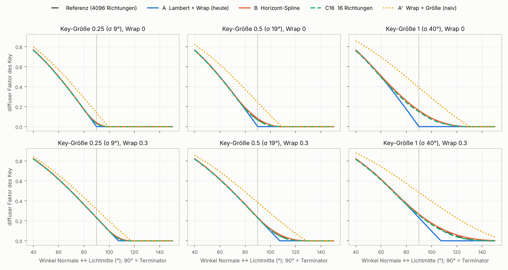
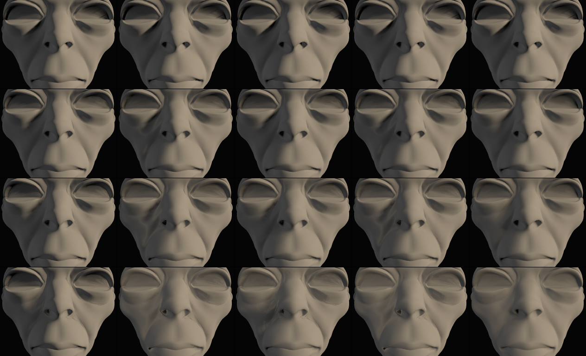
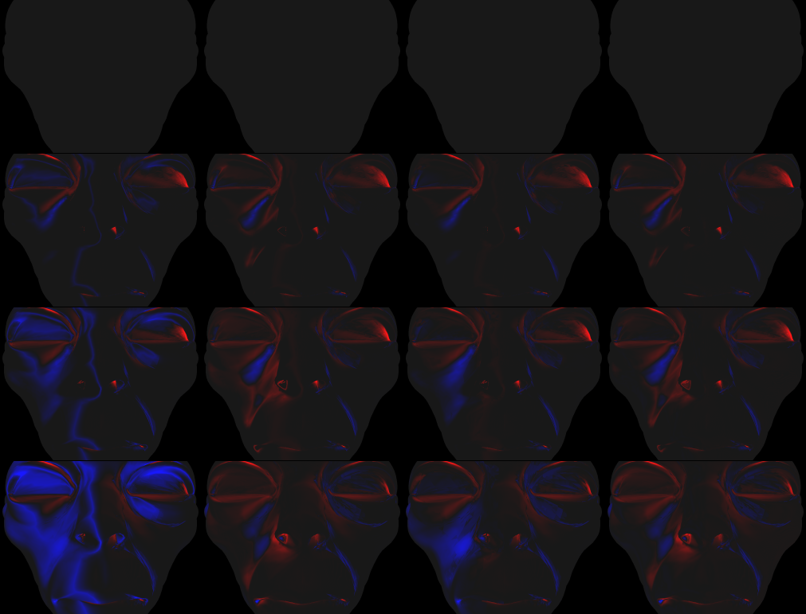
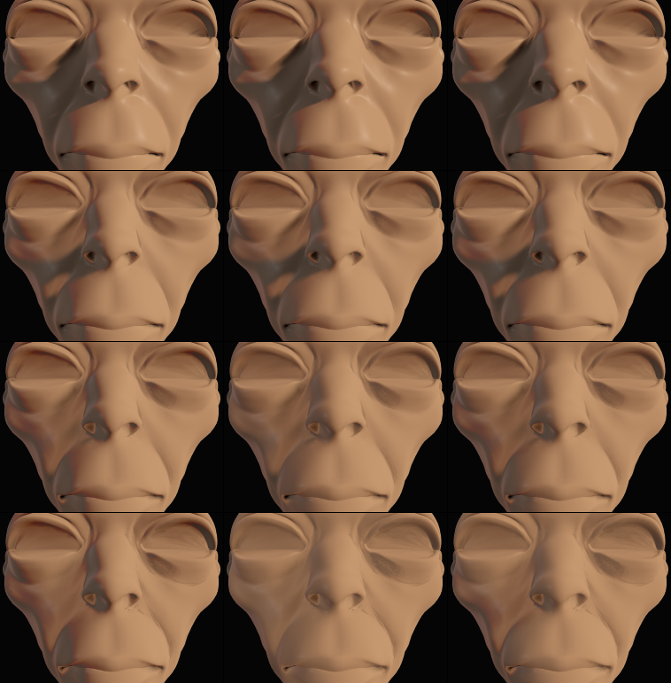
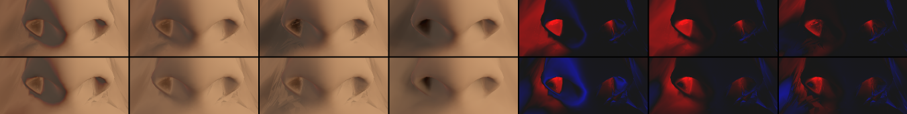
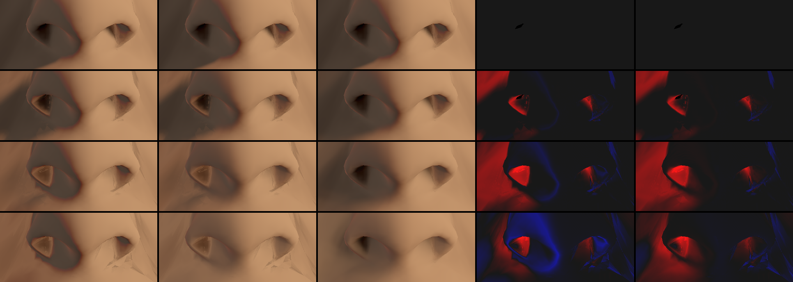

# LookDev: endliche Lichtgröße und der diffuse Terminator — Bewertung

**Status:** Forschung + isolierter Prototyp. **Entschieden 2026-11-24 (Manu): „Verfahren B bauen, als neuer P3-Effekt
vor LD-3“** - gebaut als S8 „Weiches Licht“, [AD-039 §23](../architecture/AD-039-LOOKDEV-P3.md) (Production = B
bitgleich, Effekt aus = A). Offen: Praxistest, Default an?, σ(1) 40° / 30°, der getrennte Befund §6.3. Der Text unten
ist der Stand vor der Entscheidung.
**Datum:** 2026-11-24
**Stand geprüft:** `main` @ `8f605ef` („S4 no red wash and no jagged black on the shadow side; scale 0.02“, AD-039
§19.8), Branch auf diesen Stand vorgespult, `src/` unverändert.
**Prototyp:** [`experiments/lookdev_diffuse_area/`](../../experiments/lookdev_diffuse_area/README.md) ·
Container-Lauf: [`RESULTS_CONTAINER_2026-11-24.md`](../../experiments/lookdev_diffuse_area/RESULTS_CONTAINER_2026-11-24.md) ·
Bilder: [`lookdev_diffuse_area_assets_2026-11-24/`](lookdev_diffuse_area_assets_2026-11-24/)
**Gelesen:** `lookdev_shaders.py`, `lookdev_optics.py`, `lookdev_material.py`, `lookdev_presets.py`, `gui/lookdev_model.py`,
`gui/lookdev_panel.py`, `eye_shaders.py`, `eye_optics.py`, `lookdev_shadow.py`, `lookdev_pass.py`; AD-038 (Licht, I-3,
I-6), AD-039 §2.3–§2.5, §4, §16.6–§16.7, §19.6–§19.8, RENDERING_VISION §(Haut), REFERENCE_HARDWARE.
**Evidenz:** **[V]** im Code geprüft · **[M-C]** im Container gemessen (llvmpipe: Bilder gültig, Zeiten nicht) ·
**[M-RPC]** auf dem Referenz-PC gemessen (GeForce 9800 GTX, siehe §5) · **[E]** Schätzung · **[O]** offen für Manu.

---

## Kurzfassung

- **Befund:** Der diffuse Term `ld_diffuse` rechnet jeden Studio-Licht als *Punktlicht* in seiner Mittelrichtung
  (Lambert + Material-Wrap). `StudioLight.size` erreicht nur den Glanz (`ld_lobe`) und die Schattenkarte
  (effektive Auflösung). Deshalb bleibt der Terminator hart, egal wie groß der Key ist **[V]**.
- **Verfahren B** („Horizont-Spline“, eine Auswertung je Licht): die Irradianz eines kugelförmigen Emitters mit
  Winkelradius σ, als C1-Quadrat zwischen n·l = −sin σ und +sin σ. Es liegt **0.3–1.3 %** neben der exakten Lösung und
  ist damit so genau wie 16 Abtastrichtungen (C16) und die exakte Formel (B2) **[M-C]**. Auf Gollum sind B, B2 und C16
  im Bild praktisch gleich.
- **Wirkung auf Gollum (Neutral, Größe 1):** Der Fehler der Schattenwange gegen die echte Flächenlicht-Referenz fällt
  von 19.9/255 (heute) auf 2.7/255. Bei Größe 0.5 fällt er von 5.4 auf 3.2. Der Übergang wird breit und gleichmäßig
  wie unter einer Softbox. Bei Größe 0 bleibt alles bitgenau wie heute **[M-C]**.
- **Kosten:** keine zusätzliche Texturabfrage, keine Geometrie, kein CPU- oder Upload-Anteil. Geschätzt
  ≈ 100 skalare ALU-Operationen je Pixel; das ergibt **≈ 0.1 ms (¾-Ansicht) bis ≈ 0.35 ms (Gesichts-Großaufnahme)**
  bei 1024 × 768 auf der 9800 GTX, als Obergrenze **[E]**. C16 läge bei ≈ 2–7 ms und ist damit zu teuer.
- **Risiko:** In konkaven Übergängen (Nasenflügel → Wange, Mundwinkel) gibt B bei Größe ≥ 0.5 etwas mehr weiches Licht
  als die Wahrheit, weil der zusätzliche Anteil – wie heute der Wrap – den „gehobenen“ Schatten-Lookup aus §16.7
  nimmt. Es entstehen **keine hellen Ränder**, sondern ein weicherer Nasenschatten auf der Schattenseite.
- **Nebenbefund zu P3 (gibt es schon heute, ohne B):** Der gehobene Lookup wächst mit der „Weichheit“ des Key. Mit
  Creature Skin glüht deshalb ab Größe 0.25 die Innenwand des Nasenlochs; §16.7 schützt nur bei kleinen Größen
  (Manus Test lief bei 0.03). Das ist eine eigene P3-Korrektur und wird hier **nicht** geändert (§6.3).
- **Empfehlung:** B als neuer P3-Effekt „Weiches Licht“ (eigener Schalter, **aus** als Default; Presets und
  gespeicherte Werte unverändert). Er kommt vor LD-3, damit LD-3 die Bedeutung der „Weichheit“ schon kennt. Die Kopplung
  an die Größe ist provisorisch: sin σ = Größe × sin 40°. Manu entscheidet im Praxistest.

---

## 1. Was der Code heute tut (geprüft)

| # | Behauptung aus dem Auftrag | Ergebnis | Beleg |
|---|---|---|---|
| 1 | `size` wirkt auf den Glanz über `ld_lobe(roughness, size)` | **stimmt**: α_eff² = r² + size (r = wahrgenommene Rauheit nach Specular-AA); gilt für Key, Fill, Rim, im Doppel-Glanz für beide Lobes und im Schatten-Block für den Key-Term | `lookdev_shaders.py:231-237`, `:509-518`, `:397-403` |
| 2 | Die Key-Schattenkarte nutzt `size` für ihre effektive Auflösung und damit den Halbschatten | **stimmt**: Auflösung = 1024 / (1 + 5 · size), mindestens 96; die 3 × 3 Abfragen bleiben einen Texel auseinander; der Normal-Offset (1.5 Texel) und der Wrap-Lift (4 Offsets) wachsen mit der Texelgröße | `lookdev_optics.py:413-482`, `lookdev_shaders.py:460-501` |
| 3 | `ld_diffuse()` rechnet mit der Mittelrichtung und dem Wrap | **stimmt**: `light += color[i] * ld_wrap(dot(n, dir[i]), wrap)` mit `ld_wrap = max((ndl + w) / (1 + w), 0)` plus SH9 | `lookdev_shaders.py:223-229` |
| 4 | Die diffuse Antwort nutzt `size` nicht | **stimmt**: weder `ld_diffuse` noch der `SHADOW`-Block (`lambert`, `ld_wrap(ndl, u_wrap)`) noch Backscatter lesen `u_ld_light_size` | `lookdev_shaders.py:225-229`, `:386-404`, `:424-441` |
| 5 | Wrap und Größe sind getrennte Begriffe | **im Code ja**: Wrap ist ein Materialwert (`LookMaterial.wrap` × `wrap_tint`, je Region), Größe ein Lichtwert. **In der Oberfläche nein**: beide heißen „Weichheit“ (Licht: `lookdev_panel.py:100`; Material: `lookdev_panel.py:132`) | `lookdev_material.py:42-43` |

Weitere Fakten, die die Lösung festlegen:

- **Schatten (AD-039 §16.7) [V]:** Der Key-Anteil wird mit `colour -= key · (albedo · ((1 − vis) · lambert +
  (1 − vis_wrap) · (wrap − lambert)) + (1 − vis) · glanz)` abgezogen. `vis` kommt aus der Karte am Punkt, `vis_wrap`
  vom Punkt, der 4 Normal-Offsets nach außen gehoben ist. Ein neuer diffuser Anteil muss in genau diese Aufteilung
  passen.
- **Auge [V]:** Das LOOKDEV-Auge rechnet `lit()` mit `ld_diffuse(n, vec3(0.0))` (Wrap 0, AD-038 I-6), also ebenfalls
  ohne Größe. Sein Glanz nutzt `ld_lobe`. Das weiche Hornhaut-Glanzlicht (`area_key`) hat eine **eigene** Größe aus
  `EyeLook.highlight_softness` (10° × 7.2° halbe Kantenlänge bei 1, `eye_optics.KEY_SOFT_HALF`) und ist nicht an die
  Größe des Key gekoppelt. `LD_COMMON_SRC` ist in P3 eingefroren (Pin des Augen-Shaders).
- **Presets [V]:** Key-Größen Neutral Inspection 0.25, Portrait 0.10, Soft Studio 0.35, Dramatic 0.03; Fill 0.25–0.4.

## 2. Warum der Terminator die Größe ignoriert

Ein Punktlicht ist für jede Normale entweder voll sichtbar oder gar nicht, deshalb knickt Lambert bei n·l = 0 ab. Bei
einem Emitter mit Winkelradius σ sieht eine Normale nahe dem Terminator nur einen Teil der Lichtscheibe über ihrem
Horizont. Die Helligkeit läuft deshalb über ein Band |n·l| < sin σ aus, statt abzubrechen. Dieses Band fehlt im Code
vollständig:

- Der Wrap verschiebt den Knick nur (nach n·l = −w) und dehnt die ganze Kurve. Die Kurve wird dadurch auch auf der
  Lichtseite flacher, und der Knick bleibt ein Knick. Der Wrap ist eine Materialeigenschaft (Streuung unter der Haut),
  keine Lichtgröße.
- Der weichere Schatten wirkt nur dort, wo die Karte „verdeckt“ meldet, also bei Schlagschatten. Am Terminator einer
  konvexen Form ist die Lambert-Abschneidung selbst die Kante; die Karte macht sie nicht weicher.

Das ist eine **fehlende Komponente des Lichtmodells, keine Leistungsfrage**. Den Beweis liefert die Kurvengrafik
(`curves.png`): A fällt bei 90° auf null, die Referenz läuft je nach Größe 10°–40° weiter.



*Der diffuse Faktor des Key über den Winkel zwischen Normale und Lichtmitte, oben Wrap 0, unten Wrap 0.3. B (orange)
liegt auf der Referenz (grau gestrichelt); C16 (grün) knapp daneben. A (blau) knickt ab. A' (gelb, Wrap um die Größe
erhöht) hellt die ganze Lichtseite auf.*

## 3. Größe und Wrap: getrennt halten, die Größe klar deuten

**Kombination (B):** x = n·l + w; Band-Spline auf x mit Halbbreite s = sin σ; danach durch (1 + w) geteilt. Damit
gilt:

- Bei s = 0 kommt genau `ld_wrap` heraus (Production). Bei w = 0 ist es die reine Kugellicht-Irradianz.
- Außerhalb des Bandes |x| < s ändert B **nichts**. Die Lichtseite, die Mitteltöne und die Wirkung des Wraps bleiben
  bitgleich. Die Größe macht nur den Übergang um den (gewrappten) Terminator breiter, auch bei Wrap 0.
- Der Wrap ändert Glanz und Schlagschatten nicht. Die Größe wirkt auf Glanz und Schatten wie bisher. Kein Regler
  ersetzt den anderen still.
- Die naive Alternative A' (Wrap + Größe) hellt die Lichtseite auf, bei Größe 0.5 um bis zu 0.19 (Tabelle in
  RESULTS). Sie verbreitert Lambert nur und nähert kein Flächenlicht an. Abgelehnt.

**Energie:** `u_ld_light_color` bleibt „Beleuchtungsstärke bei senkrechtem Einfall“. Bei einem Kugelstrahler
bedeutet das konstante abgegebene Leistung, unabhängig von seinem Radius. Ein größerer Key hellt dann nur das Band auf:
eine gleichmäßig beleuchtete Kugel wird im Mittel um s²/3 heller (+0.9 % bei 0.25, +3.4 % bei 0.5, +13.8 % bei 1) **[V]**
(`area_math.mean_excess`, im Test gegen das Bild geprüft). Die Alternative „Gesamtenergie konstant“ würde die Lichtseite
um bis zu 12 % dunkler machen und wird nicht empfohlen. Für die Referenzbilder ist jede der 32 Teilrichtungen mit
2 / (1 + cos σ) skaliert; so bleibt die Lichtseite exakt Lambert, und der Vergleich ist fair.

**Was bedeutet `size` heute als Winkel?** Die drei Wirkungen deuten den Wert sehr verschieden (Gollum: Kartenradius
0.996 Welteinheiten [M-C]; 1 WE ≈ 21 cm, abgeleitet aus AD-039 §16.7 „17 Texel ≈ 7 mm“):

| size | Schatten: Auflösung / Halbschatten (≈ 3 Texel) | ⇒ σ bei Abstand 7 mm (Nasenloch) | ⇒ σ bei 2.5 cm (Nase → Wange) | Glanz: α bei r = 0, Halbwertsbreite ⇒ σ | Diffus (Vorschlag) σ |
|---|---|---|---|---|---|
| 0.03 | 890 / 0.0067 WE | 5.8° | 1.6° | 0.17 ⇒ 13° | 1.1° |
| 0.10 | 683 / 0.0088 | 7.6° | 2.1° | 0.32 ⇒ 25° | 3.7° |
| 0.25 | 455 / 0.0131 | 11.3° | 3.1° | 0.50 ⇒ 44° | 9.2° |
| 0.35 | 372 / 0.0161 | 13.7° | 3.8° | 0.59 ⇒ 56° | 13.0° |
| 0.5 | 293 / 0.0204 | 17.2° | 4.9° | 0.71 ⇒ 80° | 18.7° |
| 1 | 171 / 0.0350 | 27.9° | 8.3° | 1.0 ⇒ 90° | 40.0° |

Folgerungen:

- **Eine gemeinsame physikalische Grundlage gibt es heute nicht.** Der Halbschatten über die Auflösung hängt nicht
  vom Abstand zum Verdecker ab (anders als ein echter Halbschatten), deshalb entspricht er je nach Ort einem anderen
  Winkel. Der Glanz deutet den Wert als sehr großen Emitter. Beides ist künstlerisch gestimmt, nicht abgeleitet.
- **Vorschlag:** Den Wert als *Winkelradius des Emitters* dokumentieren: sin σ = size × S_MAX mit S_MAX = sin 40°
  (`PROVISIONAL`). Bei 1 ist das eine große Softbox nah am Gesicht, bei 0.25 eine mittlere Softbox (9°; zufällig nahe
  an der halben Kantenlänge 10° der Augen-Softbox). Glanz und Schatten behalten ihre heutige Abbildung, damit die
  Presets gleich aussehen. Die σ-Tabelle macht sichtbar, wie weit sie auseinanderliegen. Eine spätere Vereinheitlichung
  (Glanz und Schatten aus σ) wäre ein eigener Schritt mit sichtbarer Look-Änderung (§8).
- Gespeicherte Werte ändern sich nicht. Der neue Effekt ist ein Schalter (aus = heute), siehe §9.

## 4. Vergleich der Verfahren

Alle Varianten laufen durch den echten LookDev-Pass: dieselbe Szene, dasselbe Licht, Kamera, Belichtung und Tonkurve,
die Schatten-Karte von Production und nur diffuse Anteile. **REF** ist ein echtes Flächenlicht: 32 Production-Bilder
mit hartem Key (Größe 0), deren Richtung über die Lichtscheibe verteilt ist, im linearen Raum gemittelt. Jede Richtung
wirft ihren eigenen Schatten; konkave Stellen, Nasenlöcher und Mundwinkel sind also physikalisch richtig. Für Wrap 0
ist REF die Wahrheit. Für Creature Skin erbt REF Productions Wrap-Regel bei Größe 0 und ist dort ein Ziel, keine
Physik.

| | **A heute** | **B Horizont-Spline** | B2 exakte Kugel | C8 / C16 Abtastung | A' Wrap + Größe |
|---|---|---|---|---|---|
| Was es ist | Punktlicht + Wrap | Näherung der Kugellicht-Irradianz (C1-Spline, in Echtzeit-Engines für Kugellichter üblich) | exakte Irradianz einer Kugel (Snyder; Form der Frostbite-Notizen) | Mittel über N Richtungen der Kappe (Vogel-Spirale) | Wrap um die Größe vergrößert |
| Flächenlicht oder nur breiter? | – | **Flächenlicht** (max. 0.3–1.3 % neben exakt) | Flächenlicht, exakt | Flächenlicht, Stufenfehler (C8 bis 4 %, C16 bis 1.5 %; Spirale leicht unsymmetrisch, Lichtseite bis ~1 % daneben) | nur breiter, hellt die Lichtseite auf |
| Terminator | harter Knick | weicher, C1-stetiger Auslauf über ±σ | wie B | wie B, bei wenig N leicht gestuft | weicher, aber verschoben und zu hell |
| Konvex (Kugel, Zylinder, Wange) | Zylinder-MAE 9.7 (Gr. 1) | **0.8** | wie B | 1.3 | – |
| Konkav (Schale, Rinne, Nase→Wange) | – | etwas zu hell bei Gr. ≥ 0.5 (s. §6.2) | wie B | wie B | – |
| Zusatzarbeit je Pixel | – | ~25 Skalar-Ops je Auswertung, 4 Auswertungen (3 Lichter + Key im Schatten-Block) | ~130 je Auswertung (acos, atan, 3 √ je Kanal) | ~30 je Richtung × N × 4 | ~0 |
| Texturabfragen | – | **0** | 0 | 0 | 0 |
| Numerik | – | Grenze s ≥ 1e-4 gegen 1/(4s); verzweigungsfrei (`step`/`mix`) | acos/atan-Ränder, Klemmung nötig | – | – |
| GL 3.3 / 9800 GTX | – | ja (nur ALU) | ja, ALU-teuer | ja, aber 20× B | ja |

**Bilder (Gollum, „face“, Neutral; Zeilen Größe 0 / 0.25 / 0.5 / 1; Spalten A · B · B-split · C16 · REF):**



Abweichung gegen REF (rot = heller als die Wahrheit, blau = dunkler, ×4; Spalten A · B · B-split · C16):



Creature Skin mit Glanz („Beauty“; Spalten A · B · B-split):



Weitere: [Formen](lookdev_diffuse_area_assets_2026-11-24/shapes_sheet_neutral.png) /
[Formen-Differenz](lookdev_diffuse_area_assets_2026-11-24/shapes_diff_neutral.png),
[Gesicht Creature Skin](lookdev_diffuse_area_assets_2026-11-24/gollum_face_sheet_creatureskin.png),
[¾-Ansicht](lookdev_diffuse_area_assets_2026-11-24/gollum_framed_sheet_creatureskin.png).

**Wie man die Bilder liest:** A wird mit wachsender Größe nicht weicher; nur der Schlagschatten wird breiter und bei
Größe 1 fleckig, weil die Karte dann nur 171 Texel hat (so ist es seit §16.6 gebaut). B, B2, C16 und REF verlaufen
gleich: Wange, Schläfe und Nasenrücken gehen breit in den Schatten über. In der ¾-Ansicht (Kamera 35°, Key 70°) ist die
Wirkung kleiner, weil der Terminator dort meist hinter der Form liegt.

## 5. Leistung

**Gemessen [M-C]:** Nur eine Funktionsprüfung. Alle Varianten kompilieren unter GL 3.3 core und zeichnen; der
GL-Fehlerstatus bleibt 0. Die llvmpipe-Zeiten streuen um Millisekunden und sind keine GPU-Zeiten; sie werden nicht
ausgewertet.

**Geschätzt [E]**, Obergrenze bei reiner ALU-Last. 9800 GTX: 128 Shader-Einheiten × 1.69 GHz ≈ 216 G skalare Ops/s.
Bedeckung des Kopfes bei 1024 × 768 im Container gemessen: ¾-Ansicht 22.6 % (177 k Pixel), Gesicht 79.9 % (628 k
Pixel); Zuschlag 1.15 für 2×2-Quads und Überzeichnung.

| | ¾ 1024×768 | Gesicht 1024×768 | ¾ 1920×1080 | Gesicht 1920×1080 |
|---|---|---|---|---|
| **B** (≈ 100 Ops/Pixel) | **≈ 0.09 ms** | **≈ 0.33 ms** | ≈ 0.25 ms | ≈ 0.9 ms |
| B2 (≈ 520) | ≈ 0.5 ms | ≈ 1.7 ms | ≈ 1.3 ms | ≈ 4.6 ms |
| C16 (≈ 2000) | ≈ 1.9 ms | ≈ 6.7 ms | ≈ 5 ms | ≈ 18 ms |

- Die Kosten steigen linear mit den Pixeln. Die SubD-Stufe ändert sie kaum (nur über Überzeichnung), weil B nur im
  Fragment rechnet.
- Der Haut-Pass ist heute vermutlich eher durch Abfragen gebunden (18 Vergleichsabfragen Schatten, 4 Rohtiefe,
  Cube). B ist reine ALU-Arbeit und kann sich in deren Latenz verstecken; die Obergrenze ist deshalb eher pessimistisch.
- **Budget (AD-039 §2.5):** pro Effekt +0.3 bis +0.5 ms; alle P3-Effekte ≤ 9.5 ms. B liegt darin, C16 nicht.
  B2 bringt gegenüber B keinen sichtbaren Gewinn und kostet etwa das Fünffache.
- Keine neue Geometrie, keine CPU-Arbeit pro Vertex, keine Uploads: B liest nur `u_ld_light_size`, das schon jeden
  Frame da ist.

**Referenz-PC [M-RPC]:** Beide Läufe auf der GeForce 9800 GTX wurden am 2026-11-24 erfolgreich ausgeführt. Das vollständige Protokoll steht in [RESULTS_REFERENCE_PC_2026-11-24.md](../../experiments/lookdev_diffuse_area/RESULTS_REFERENCE_PC_2026-11-24.md). Die Messung bestätigt B's niedrige Zusatzkosten; Details und Einordnung folgen direkt unten.


### Referenz-PC: GeForce 9800 GTX [M-RPC], 2026-11-24

Manu führte `bench.py` auf der dokumentierten Referenzhardware aus: Q9550, GeForce 9800 GTX, OpenGL 3.3, CPython 3.12.10. Beide Auflösungen wurden mit 20 Runden × 3 Frames je Variante nach 5 Warm-up-Frames gemessen; die Varianten liefen verschachtelt. Der gemessene Quellstand war Commit `8347c42619`, `src/`-Tree `c51b82c960`.

**Isolierter Zusatzaufwand von B**, ermittelt mit `(Bx16 − Ax16) / 16` (vier diffuse Auswertungen je Pixel):

| Auflösung | Oberfläche / Ansicht | B eigener GPU-Aufwand | B GPU p50 | Anteil am 33.3-ms-Budget |
|---|---|---:|---:|---:|
| 1024 × 768 | Cage, framed | 0.129 ms | 4.696 ms | 14.1 % |
| 1024 × 768 | Cage, face | 0.370 ms | 12.388 ms | 37.2 % |
| 1024 × 768 | SubD 1, framed | 0.198 ms | 6.858 ms | 20.6 % |
| 1024 × 768 | SubD 1, face | 0.448 ms | 15.741 ms | 47.2 % |
| 1920 × 1080 | Cage, framed | 0.215 ms | 6.838 ms | 20.5 % |
| 1920 × 1080 | Cage, face | 0.659 ms | 20.627 ms | 61.9 % |
| 1920 × 1080 | SubD 1, framed | 0.293 ms | 9.853 ms | 29.6 % |
| 1920 × 1080 | SubD 1, face | 0.776 ms | 24.753 ms | 74.3 % |

**Einordnung:**

- Die frühere Schätzung für 1024 × 768 (0.09–0.35 ms) lag in der richtigen Größenordnung, unterschätzte aber die SubD-Gesichts-Nahaufnahme: gemessen 0.448 ms. Damit liegt B dort knapp unter dem oberen P3-Richtwert von +0.5 ms pro Effekt.
- Bei 1920 × 1080 steigt B's eigener Aufwand auf 0.215–0.776 ms. In der teuersten getesteten Einstellung (SubD 1, face) bleibt der ganze LookDev-GPU-Frame mit B bei 24.753 ms und damit unter 33.3 ms; die Reserve sinkt aber auf rund 8.5 ms.
- B2 und C16 sind deutlich teurer. C16 überschreitet bei 1920 × 1080, SubD 1, face mit 39.026 ms das 30-FPS-GPU-Budget. B bleibt in derselben Konfiguration darunter.
- `B − A` und der isolierte x16-Wert sind nicht identisch: Für den reinen Shader-Aufwand ist die verstärkte Differenz `(Bx16 − Ax16) / 16` robuster gegen das Messrauschen. Beide Messwerte stehen im vollständigen Protokoll.
- `glGetError` war am Ende beider Läufe `0x0000`.

Das Ergebnis bestätigt die Performance-Eignung von B auf der realen Referenz-GPU. Es ist **keine** visuelle Freigabe: die Risiken um konkave Übergänge und den bestehenden Wrap-Lift aus §6.2–§6.3 müssen weiterhin gelöst beziehungsweise praktisch beurteilt werden.

Das vollständige Protokoll mit Min/Max-, CPU- und GPU-Werten für alle Varianten steht in [RESULTS_REFERENCE_PC_2026-11-24.md](../../experiments/lookdev_diffuse_area/RESULTS_REFERENCE_PC_2026-11-24.md).

## 6. Verträglichkeit und Bildrisiken

### 6.1 Schatten aus P3 (S1)

- **Echte Schlagschatten bleiben dunkel:** Auf Flächen, die zum Licht zeigen (n·l > s), ändert B nichts. Der
  Lambert-Anteil nimmt weiter `vis` am Punkt. **Kein doppelt weicher Halbschatten:** Der Halbschatten entsteht weiter
  nur durch die Karte. B wirkt nur im Terminator-Band, und das liegt unter `vis_wrap` wie der Wrap.
- **Anderes Ungleichgewicht:** Ein echtes 40°-Licht würde auch die Schlagschatten viel weicher machen (REF: Nasen-
  und Schalenschatten zerfließen). Production bleibt bei Größe 1 schärfer, etwa 8° bei Abstand 2.5 cm. Mit B wird der
  Terminator also weicher als die Schlagschatten. Das ist stimmig lesbar und keine Regression. Ein abstandsabhängiger
  Halbschatten (Blocker-Suche, PCSS) wäre ein eigener Schatten-Vorschlag mit +16–32 Abfragen, nicht Teil dieses Schritts.

### 6.2 Konkave Stellen und Nasenlöcher (der §16.6/§16.7-Konflikt)

Eine einzige Karte aus der Lichtmitte kann zwei Fälle nicht unterscheiden. Jenseits eines **konvexen** Terminators
sieht der Punkt einen Teil des Emitters, aber die Karte meldet „verdeckt“, weil die eigene Vorderseite davorliegt. In
einer **Falte** (Nasenflügel → Wange, Mundwinkel) ist der Punkt wirklich verdeckt. Getestet wurden drei Regeln für B's
zusätzlichen Anteil:

| Regel | konvex (Schattenwange, Neutral Gr. 1, MAE) | Nase „neu heller“ (Neutral Gr. 1) | Bild |
|---|---|---|---|
| **lifted** (wie der Wrap: §16.7-Lookup) | **2.7** (A: 19.9) | 16 % der Pixel, p99 30/255 | weicher Nasenschatten auf der Schattenseite; **keine** Ränder |
| split (Band unter `vis` wie Lambert) | 14.3 | 0.8 % | sicher, aber der Effekt fehlt weitgehend: die Karte schneidet ihn hinter dem Terminator ab |
| lifted mit kleinerem Lift („mid“: √ der Skalierung; ändert auch den Wrap) | 4.4 | 6.7 % | **§16.6-Streifen und -Flecken kommen zurück** (Bild unten) |



*Creature Skin, Zeilen Größe 0.5 / 1; Spalten A · B · B-liftmid · REF, dann die Differenzen. In B-liftmid stehen
Streifen auf der Wange neben der Nase.*

Ergebnis: **„lifted“** ist von den drei Regeln die einzige ohne neue Artefakte. Ihr Fehler ist ein weiches Zuviel in
Falten bei großen Größen; bei 0.25 ist er klein (Nase neu heller 2 %, p99 12/255). An den Mundwinkeln: Neutral Gr. 1 neu
heller 6.8 %, p99 22/255, **keine** hellen Ränder wie im §16.7-Bild. Formen: Schale/Rinne neu heller 5–11 %, p99 bis
40/255 bei Größe 1. Die Formen-Szene ist mehrere Male größer als der Kopf, ihre Karte also gröber und der Lift im Verhältnis zur
Rinne groß. Im Gesicht sind die Werte kleiner.

### 6.3 Ein vorhandener P3-Befund (unabhängig von B)

Der gehobene Lookup liegt 4 Normal-Offsets nach außen. Ein Offset ist 1.5 Texel der **effektiven** Karte; bei Größe 1
sind das 6 × 0.0117 = 0.07 WE (≈ 1.5 cm), bei 0.25 noch 0.026 WE. Damit springt der Lookup bei größerer „Weichheit“
aus dem Nasenloch heraus. Mit Creature Skin bekommt die Innenwand des linken Nasenlochs dann Wrap-Licht, obwohl sie
im Schatten des Nasenflügels liegt. **Production A** zeigt das schon heute:



*Creature Skin, Zeilen Größe 0 / 0.25 / 0.5 / 1; Spalten A · B · REF, Differenzen A und B. Bei 0 ist alles gleich;
ab 0.25 leuchtet das linke Nasenloch in A (p99 34–40/255 über REF) und in B gleich stark.*

§16.7 löste die Ränder bei Größe 0.03 (Manus Bild). Für Soft Studio (0.35) und Neutral Inspection (0.25) gilt der
Schutz nur noch teilweise. Ein Lift mit fester Weltlänge verhindert das, bringt aber bei kleiner Karte die
Facettenflecken aus §16.6 zurück (B-liftmid oben). Die Korrektur braucht deshalb einen eigenen kleinen Vorschlag,
etwa „Lift fest in Welteinheiten, Karte ab Größe X nicht kleiner als Y Texel“, mit Manus Blick. **Hier wird P3 nicht
geändert** (Auftrag §6).

### 6.4 Auge

Der Augen-Shader bleibt unverändert. Bewertung für später:

- **Lederhaut / `lit()`:** Sollte langfristig dieselbe Funktion nutzen (Wrap 0, ein Aufruf, ≈ 25 Ops). Sonst hat bei
  großem Key die Haut einen weichen Terminator und der Augapfel einen harten; sichtbar wäre das nur bei starkem
  Seitenlicht, weil die Lider den Terminator meist verdecken. Das Auge hat einen einzigen Sichtbarkeitswert je
  Hüllpunkt (`ld_key_vis`); der Bandanteil nähme ihn mit wie Lambert.
- **Iris (`iris_lit`)** rechnet den Key durch die Hornhaut (Tabelle) und bleibt außen vor.
- **Hornhaut-Glanzlicht:** Seine Softbox-Größe kommt aus `EyeLook.highlight_softness`, nicht aus der Größe des Key.
  Eine gemeinsame Deutung (σ des Key → Größe der Augen-Softbox) wäre stimmig, ändert aber die Bedeutung eines Augenwerts
  und ist eine eigene Entscheidung.
- Weil `LD_COMMON_SRC` eingefroren ist, gehört die Änderung **nicht** in `ld_diffuse`, sondern in einen eigenen
  Haut-String (§9). Für das Auge folgt später ein eigener Schritt mit neuem Augen-Pin.

### 6.5 Sonstiges

- **Fill und Rim** bekommen das Band mit ihrer eigenen Größe. Bei Fill-Größen 0.25–0.4 wird der Fill-Terminator
  9°–15° weich, unverschattet wie heute ihr Wrap.
- **Normal-Map:** B nutzt die Schattierungsnormale wie Lambert; die Schatten-Abfragen bleiben bei `n_geo`.
- **Backscatter / Durchleuchtung (S4)** und SH9 bleiben unverändert.
- **Benennung:** Zwei Regler heißen „Weichheit“. Mit B wirkt die Licht-Weichheit sichtbar auf die Form, die
  Material-Weichheit (Wrap) ebenso. Vorschlag für später, kein Redesign jetzt: das Material-Feld „Wrap“ oder
  „Hautweichheit“ nennen [O].

## 7. Empfehlung für Mirai

1. **B (Horizont-Spline) mit der „lifted“-Regel** als diffuser Flächenlicht-Term für Key, Fill und Rim. Gründe: im Bild
   gleich wie die 16-Richtungen-Abtastung und die exakte Formel; ≈ 5–20× billiger; keine Abfragen; bei Größe 0
   bitgleich; trennt Größe und Wrap sauber.
2. **Abbildung** sin σ = size × sin 40° (`PROVISIONAL`). Bei den Presets ergibt das σ = 1° (Dramatic), 4° (Portrait),
   9° (Neutral Inspection), 13° (Soft Studio): eine maßvolle Änderung. Größe 0.5 bis 1 ist der Bereich für eine
   „große Softbox“.
3. **Kein C**, auch nicht als Qualitätsstufe: C16 sieht nicht besser aus als B und kostet das Zwanzigfache. Als
   Referenz bleibt der Mehrfach-Render im Experiment (`run_compare.py`), denn er ist genauer als C.
4. **Der P3-Befund §6.3** (Wrap-Lift wächst mit der Weichheit) wird als eigener P3-Korrekturvorschlag geführt. Er
   betrifft den Wrap auch ohne B.

## 8. Reihenfolge: vor LD-3 oder später?

**Empfehlung: in P3, vor LD-3**, als Nachtrag-Slice „S8 Weiches Licht“ mit fester Einstellung. Gründe:

- LD-3 entwirft die Regler und Qualitätsstufen einmal (AD-039 §0.1, Vorschlag §12.3). Was „Weichheit“ bedeutet (σ des
  Emitters), sollte vorher feststehen.
- B braucht keinen LD-3-Regler: keine Abfragen, keine Auflösung, kein Stufenwert. Es passt ins P3-Muster „ein Effekt,
  ein Define, aus = Pins von heute“.
- Das Risiko ist klein und schaltbar (Effekt-Schalter, aus als Default bis Manus Entscheidung).

**Aufschieben** (P4 / LD-3+): die Vereinheitlichung von Glanz- und Schattenabbildung auf σ (sichtbare Look-Änderung
aller Presets) und ein abstandsabhängiger Halbschatten. **Getrennt:** der P3-Befund §6.3.

## 9. Umsetzungsvorschlag (nach Manus Freigabe)

**Shader (`lookdev_shaders.py`):**

- Neuer Haut-String `LD_AREA_SRC`, nur angehängt mit dem Define `AREA_DIFFUSE`. `LD_COMMON_SRC` bleibt unverändert
  (Augen-Pin).
  ```glsl
  const float LD_AREA_SIN_MAX = 0.6427876;  // sin 40° (PROVISIONAL)
  // light i's diffuse factor: the sphere light's irradiance as the C1 horizon spline, the cosine shifted by the wrap
  vec3 ld_area_wrap(float ndl, vec3 w, float size) {
      float s = max(size * LD_AREA_SIN_MAX, 1e-4);
      vec3 x = vec3(ndl) + w;
      vec3 t = max(x + s, 0.0);
      return mix(t * t / (4.0 * s), x, step(vec3(s), x)) / (vec3(1.0) + w);
  }
  vec3 ld_diffuse_area(vec3 n, vec3 wrap) {
      vec3 light = ld_env_diffuse(n);
      for (int i = 0; i < LD_LIGHTS; ++i)
          light += u_ld_light_color[i] * ld_area_wrap(dot(n, u_ld_light_dir[i]), wrap, u_ld_light_size[i]);
      return light;
  }
  ```
- `SKIN_BODY`: In einem `#ifdef AREA_DIFFUSE`-Block ruft der Körper `ld_diffuse_area(n, u_wrap)` statt `ld_diffuse`
  auf (beide `DUAL_LOBE`-Zweige). Im `SHADOW`-Block steht `ld_area_wrap(ndl, u_wrap, u_ld_light_size[0])` statt
  `ld_wrap(ndl, u_wrap)`, unter `vis_wrap` wie heute. Keine neue Uniform, keine neue Textureinheit.
- `skin_sources(..., area_diffuse=False)`; der Programmschlüssel bekommt das Flag.

**Optik-Zwillinge (`lookdev_optics.py`):** `ld_area_wrap`, `ld_diffuse_area`, `ld_key_shadowed(..., area=True)`; dazu
`AREA_SIN_MAX` aus dem Shader-Modul.

**Effekt-Schalter:** `LookdevEffects.area_diffuse` (Panel „Effekte“: „Weiches Licht“, Hinweis: „‚Weichheit‘ des Lichts
macht auch den Übergang ins Dunkle weicher“). Er ist View-State wie die anderen, aus als Default, kein Feature-Check
nötig. Presets, `StudioLight`-Werte, Szenen- und `view.lookdev`-Format bleiben unverändert (der neue Schalter wird
defensiv gelesen wie die übrigen).

**Tests:**

- Pins: Mit allen Effekten aus bleiben `PINNED_SKIN_SOURCES_SHA256` und der Augen-Pin gleich; `AREA_DIFFUSE` ohne
  Größe ist bild-gleich (Parität bei size 0).
- Zwillinge: `test_lookdev_optics` (Punktlicht = `ld_wrap`; Lichtseite unverändert; Spline ≥ Wrap, C1; wächst mit der
  Größe auch bei Wrap 0; Abstand zur dichten Referenz ≤ 2 %); GPU-Parität in `test_gl_lookdev_parity.py`.
- Schatten: `test_a_cast_shadow_at_a_grazing_key_keeps_the_wrap_and_the_highlight_dark` und
  `test_the_wrap_past_a_convex_terminator_is_not_cut` zusätzlich mit `area_diffuse` und Größe 0.5.
- Room-Probe-Zeile `lookdev +area` (Ziel ≤ +0.3 ms gegen `lookdev`); Referenz-PC-Lauf von `bench.py` vorab.

**Praxistest (Manu, ≈ 10 min):** `Gollum_Head_05`, Studio Dramatic, Creature Skin, Key-Weichheit 0 / 0.25 / 0.5 / 1,
„Weiches Licht“ an/aus. Prüfen: Wange und Schläfe; Nasenloch und Mundwinkel (hellt etwas auf, wo es nicht soll?);
Gesamthelligkeit. Danach entscheiden: Default an? S_MAX (40° / 30°)?

---

## Offene Entscheidungen für Manu [O]

1. Soll B als Effekt „Weiches Licht“ in P3 (vor LD-3) gebaut werden?
2. Abbildung: σ(1) = 40° behalten oder kleiner (z. B. 30°)?
3. Soll der P3-Befund §6.3 (Wrap-Lift wächst mit der Weichheit, Nasenloch glüht ab 0.25) als eigener
   Korrekturvorschlag folgen?
4. Später: das Auge (`lit`, Hornhaut-Softbox) an dieselbe Deutung anschließen; das Material-Feld „Weichheit“ umbenennen?
