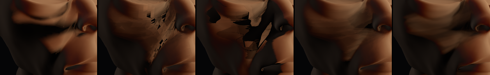
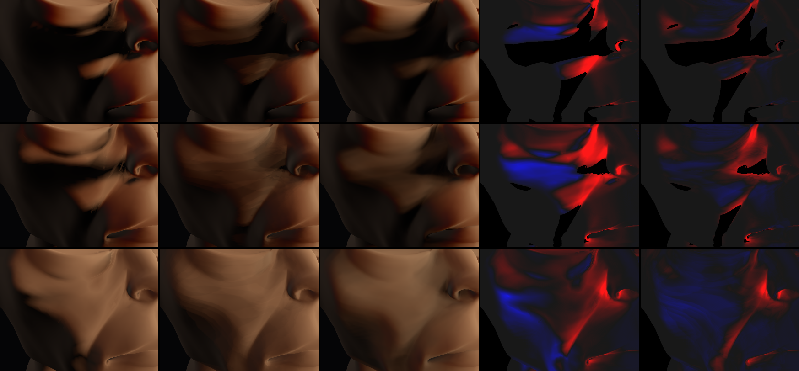
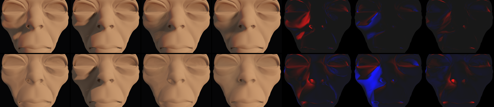

# LookDev: Halbschatten des Key abhängig vom Abstand (PCSS) — Bewertung

**Datum:** 2026-11-24
**Status:** Bewertung mit Empfehlung. Forschung plus isolierter Prototyp in
[`experiments/lookdev_pcss/`](../../experiments/lookdev_pcss/README.md), **kein Production-Code**.
**Stopp hier:** Der Einbau in `src/` folgt erst nach Manus Referenz-PC-Zahlen und seinem Go.
**Stand 2026-11-24, nach dem Referenz-PC-Lauf (§8.2):** Das Bild-Ergebnis gilt. Die Kosten verfehlen das Budget aber
um das 3- bis 12-Fache. **K16c wird so nicht eingebaut.** Nächster Schritt ist ein Diagnose-Lauf (§8.3), danach
entscheidet Manu den Weg (Q-PCSS-5).
**Basis:** AD-039 §23 (S8 „Weiches Licht“, `22a34b0`) und §23.6 (Manus Befund, `ab286c4`); Bewertung
[LOOKDEV_DIFFUSE_AREA_LIGHT_TERMINATOR_ASSESSMENT_2026-11-24](LOOKDEV_DIFFUSE_AREA_LIGHT_TERMINATOR_ASSESSMENT_2026-11-24.md)
§3 und §6.1–§6.3.
**Evidenz:**
- **[M-C]** im Container gemessen (llvmpipe, Bilder und Kennzahlen; gleicher Shader-Text wie auf der GPU).
- **[E]** geschätzt.
- **[M-RPC]** auf Manus Referenz-PC gemessen (GeForce 9800 GTX).
- **[O]** Entscheidung von Manu.

## Kurzfassung

**Befund (Manu, 2026-11-24):** „Der Übergang von Nase zur Wange links wirkt bei weichem Licht seltsam/unrealistisch.“
„Weiches Licht“ macht den Terminator mit σ weich. Der Schlagschatten der Nase behält dagegen den festen Halbschatten
der Karte, etwa 3 Texel der effektiven Auflösung. So entsteht ein harter dunkler Keil in einer weich beleuchteten
Wange.

**Prototyp:** Der Haut-Shader wird nur im Experiment-Prozess gepatcht. Verglichen werden Blocker-Suche + PCF mit
variablem Radius gegen eine Referenz aus 32 harten Keys über die Lichtscheibe (REF). Getestet wurden 4 Ansichten,
2 Materialien und die Key-Größen 0 / 0.25 / 0.45 / 1.

**Ergebnis [M-C]:** Das empfohlene Verfahren **K16c** liegt in **allen 24 Bildsätzen mit Größe > 0 näher an REF als
Production**: mittlerer Fehler 1.89/255 statt 2.87/255. In Manus Ansicht bei 0.45 mit Creature Skin* sind es 4.12
statt 7.26, Region Nase → Wange 7.1 statt 17.2. Der harte Keil wird zur breiten, weichen Abdunklung wie in REF. Die
Treppen verschwinden, weil die Karte in voller Auflösung bleibt. Kontaktschatten bleiben scharf. Auf der beleuchteten
Kugel gibt es keine Akne. Die §16.6-Facettenflecken kommen nicht zurück.

**Was dafür nötig war:** Ein Lehrbuch-PCSS mit Receiver-Plane über breite Kerne erzeugt auf dem Gollum-Kopf Facetten
und schwarze Dreiecke (§3). Das Verfahren vergleicht deshalb weiter außen gegen die **Höhe der gefundenen Blocker**
statt gegen die Ebene des Empfängers. Nur nahe der Mitte gilt die Ebene wie heute. Außerdem braucht es einen
**gehobenen Lookup, der mit σ wächst** (0.23 · R · s³ statt heute linear über die Texelgröße). Das löst innerhalb des
neuen Effekts auch den Befund §6.3 (Nasenloch-Glühen).

**Kosten [M-RPC] (§8.2):** K16c kostet bei 1024 × 768 +1.4 bis +6.1 ms (Mittel +3.2), bei 1920 × 1080 im Mittel
+5.1 ms. Erlaubt sind ≤ +0.5 ms. Teuer ist die Nahansicht „face“, in der die Haut den Bildschirm füllt.
- Die Kosten folgen **nicht** der Zahl der Abfragen: 8, 16 oder 24 Such-Abfragen, 16 oder 32 PCF-Abfragen und ein
  3 × 3-Gitter kosten im Mittel alle +3.2 bis +3.5 ms.
- Der Frühabbruch kostet mehr, als er spart (ohne: Mittel +2.3 ms).
- Volle Auflösung allein kostet nichts (+0.04 ms).
- Vermutung [E]: Der größere Haut-Shader senkt die Auslastung der G92 (Register), oder die Verzweigung divergiert.
  Weniger Abfragen sind also kein wirksamer Hebel.

**Empfehlung (revidiert):**
- K16c ist **im Bild** das richtige Verfahren, wird aber **so nicht eingebaut**.
- Erst der Diagnose-Lauf `bench.py --set diag` (§8.3, wenige Minuten). Er trennt Shader-Größe, Suche, PCF,
  Schleifen-Entrollung und Texture-Cache und misst eine schlanke Form mit gleichem Bild.
- Danach drei Wege (Q-PCSS-5):
  - die günstigste K-Form mit einer bewussten Budget-Ausnahme für einen Effekt, der standardmäßig aus ist;
  - ein vorgefilterter Ansatz mit Ereigniskosten statt Frame-Kosten (neuer Prototyp);
  - Verzicht.
- Unverändert für jeden späteren Einbau: eigener Schalter „Weicher Schatten“ (braucht „Schatten“), Standard aus;
  aus = alle Pins bitgleich; das Auge bleibt beim alten Lookup (§7).

**Offene Entscheidungen:** Q-PCSS-1 bis Q-PCSS-5 am Ende.

## 1. Ausgangslage (geprüft am Code, `ab286c4`)

- **S1-Lookup** (`LD_SHADOW_SRC`): 3 × 3 bilineare Vergleichs-Abfragen, einen Texel auseinander, mit
  Receiver-Plane-Bias aus den Bildschirm-Ableitungen. Er wird zweimal ausgeführt:
  - am Punkt: `vis`, für Lambert und Glanz;
  - 4 Normal-Offsets nach außen gehoben: `vis_wrap`, für den Überschuss von Wrap und Band (§16.7, S8 Regel „lifted“).
- **Weichheit = effektive Auflösung:** 1024 / (1 + 5 · Größe) Texel (§16.6). Der Halbschatten ist ≈ 3 Texel breit,
  unabhängig vom Abstand zum Werfer. Der Lift wächst mit der Texelgröße, also linear mit der Größe (Bewertung §6.3).
- **Diagnose in Manus Ansicht** (`debug_vis.py`, Key 70° / 9°): Fast die ganze linke Wange liegt **hinter dem
  Terminator** (n·l < 0). Dort leuchten nur Wrap 0.5 und das Band von „Weiches Licht“, und `vis_wrap` entscheidet.
  - Production lässt die Wange nur deshalb hell, weil der Lift bei grober Karte groß ist (0.038 WE bei 0.45).
  - Bei voller Auflösung (Zeile **F**) liegt die Wange im eigenen Körperschatten: Größe 1 hat MAE 23.4.
  - Der Keil selbst ist der 3-Texel-Halbschatten der Nase in `vis_wrap`.

## 2. Prototyp und Referenz

- **Patch** (`pcss_glsl.py`):
  - Die beiden Aufrufe im `SHADOW`-Block werden durch `ldx_key_shadow` ersetzt; es liefert (vis, vis_wrap).
  - Die Karte wird in voller Auflösung gerendert (`shadow_resolution` ersetzt).
  - Die Rohtiefe (S4-Sampler, Einheit 7) wird bei jedem Haut-Draw mit Schatten gebunden.
  - Jeder Anker wird geprüft. Die Kopflos-Tests decken alle Effekt-Kombinationen ab (21 Tests).
- **REF** (`compare.render_reference`):
  - Production bei Größe 0: harte Karte in voller Auflösung, Punktlicht.
  - 32 Richtungen über die Kappe mit sin σ = Größe × sin 40° (die S8-Abbildung), jeweils × 2 / (1 + cos σ).
  - Gemittelt in linearem Licht. Jeder Key wirft seinen eigenen harten Schatten, also hat REF echte, vom Abstand
    abhängige Halbschatten.
- **Bilder:** immer mit „Weiches Licht“ an, Schatten und Doppel-Glanz an, Albedo „Farbe“, Augen aus (`--eyes` für
  §7). Zahlen nur diffus (ohne Glanz), linear erfasst, Tonkurve in NumPy.
- **Ansichten:**
  - „manu“: Manus Einstellung aus §23.6, Dramatic 5°, Key 2.2 bei 70° / 9°, 4800 K, Fill und Rim aus; die Kamera
    bei −35° auf der Schattenseite.
  - „face“ und „framed“ aus `run_compare` mit dem Studienlicht 70° / 20°.
  - Formen-Szene: Kugel, Zylinder, Platte mit Schale und Rinne.
- **Materialien:** Neutral (Wrap 0) und **Creature Skin\*** (Manus Werte: Rauheit 0.5, Glanz 0.35, Weichheit 0.5,
  Durchscheinen 0).
- **Kennzahlen:**
  - Luminanzfehler gegen REF (0–255): MAE, Anteil > 8/255 heller oder dunkler, p99.
  - Pro Region (`analyze.py`) zusätzlich `new+`: Pixel, die nur in der Variante, nicht in Production, > 8/255
    heller sind (Leck, heller Rand).

## 3. Was nicht trägt, und warum

Die Stufen sind festgehalten, weil sie die Konstruktion von K16c begründen ([M-C], Manus Ansicht, 0.45, Creature
Skin\*):



*Spalten: P (heute) · PCSS mit Receiver-Plane aus den Ableitungen · Plane aus der glatten Normale · „L“ (ohne Plane,
Blocker-Höhe) · REF (16 Richtungen).*

| Stufe | Ergebnis | Ursache |
|---|---|---|
| Lehrbuch-PCSS: Blocker-Suche und PCF gegen die Receiver-Plane aus `dFdx/dFdy` | weich, aber Facetten und schwarze Dreiecke an der Wange | Die Ebene ist pro Dreieck konstant. Bei 9° Key-Höhe ist ihre Steigung groß (oft auf 10 gekappt). Über 20–40 Texel extrapoliert, liegt der Fehler weit über dem Bias. Hinter dem Terminator ist die Ebene eines abgewandten Dreiecks bedeutungslos |
| Plane aus der glatten Normale | große schwarze Flächen | Bei streifendem Licht ist jede Ebene schlecht konditioniert; der Fehler der glatten Normale wird ebenfalls verstärkt |
| ohne Plane: Kegeltest in der Suche, PCF gegen die halbe Blocker-Höhe („L“) | sauber bei 0.25/0.45; bei Größe 1 ganzes Gesicht zu dunkel, fleckige Grenzen | Bei σ = 40° hebt sich die eigene gekrümmte Fläche im Kern (48 Texel) über die halbe Blocker-Höhe. Der Frühabbruch schaltet hart zwischen 1 und dem PCF-Wert |
| feste Weltlänge für den Lift (volle Auflösung, 6 Texel) | Größe 1 viel zu dunkel (MAE 11.7 statt 6.5, `K16c-bl0`) | Im Band n·l ∈ (−s, 0) kommt die gehobene Abfrage nicht aus dem eigenen Körperschatten |
| Lift aus der gemessenen Sehne (Blocker-Abstand × −n·l / 4) | schlechter bei 0.25 und 1 | Die Suche (begrenzter Radius) schätzt die Sehne zu unruhig |
| Grid statt Vogel-Scheibe (`K16c/9g`, 3 × 3 PCF) | MAE 2.87 wie P, stufige Halbschatten | Bei breitem Kern deckt eine Abfrage nur 2 Texel; ein Gitter ergibt sichtbare Stufen |
| effektive statt voller Auflösung (`K16c-eff`) | Creature Skin\* 0.25/0.45 schlechter als P | Der Lift wächst wieder mit der Texelgröße: Nasenloch-Glühen (§6.3); die Treppen bleiben |

## 4. Das empfohlene Verfahren: K16c

Pro Haut-Fragment mit Schatten. `sp` ist der Kartenpunkt wie heute, `spl` der gehobene. Die Karte ist orthografisch,
ihre UV und ihre Tiefe überspannen beide 2R. Deshalb **ist** ein Tiefenunterschied in Karteneinheiten direkt eine
UV-Länge: Halbschatten-Radius = Δz · tan σ, ohne weitere Uniform.

1. **σ:** sin σ = Größe × sin 40°. Das ist die S8-Abbildung (`AREA_SIN_MAX`), also dasselbe σ für Terminator-Band,
   Schatten und REF.
2. **Blocker-Suche:** 16 Rohtiefe-Abfragen.
   - Lage: Vogel-Spirale mit linear wachsendem Radius, also **zur Mitte verdichtet**, damit dünne Kontakt-Werfer wie
     Lippenfuge und Nasenflügelrand nicht durchrutschen.
   - Suchradius: 0.15 · 2R · tan σ, mindestens 2 Texel, höchstens 48 Texel.
   - Blocker-Test je Abfrage im Abstand o: nahe der Mitte die **Receiver-Plane wie heute**; ab 1.5 bis 3.75 Texel
     weich überblendet zum **Kegeltest**: liegt mehr als 2 · |o| über dem Empfänger.
3. **Frühabbruch:** Ohne Blocker ist der Punkt lit (vis = vis_wrap = 1). Die Ableitungen sind vorher genommen.
4. **Radius:** r = clamp((z − mittlere Blocker-Tiefe) · tan σ, 1 Texel, 48 Texel).
5. **PCF:** 16 bilineare Vergleichs-Abfragen auf der Vogel-Scheibe mit Radius r.
   - am Punkt → `vis`;
   - am gehobenen Punkt → `vis_wrap`, mit **derselben** Suche.
   - Vergleich: nahe der Mitte die Receiver-Plane, weiter außen „Abfrage ist Schatten, wenn die Fläche dort mehr als
     0.5 × (z − Blocker-Tiefe) über dem Empfänger liegt“.

   Dadurch ist die eigene Fläche kein Blocker, echte Werfer wie die Nase aber schon.
6. **Einblendung:** Die PCF zählt erst ab 4 gefundenen Blockern voll (min(Anzahl / 4, 1)). Ein oder zwei Treffer am
   Rand des Kegels schalten also nicht hart um.
7. **Lift:** `LD_SHADOW_WRAP_LIFT` (4 Offsets) + 0.23 · R · s³ / Offset.
   - Bei voller Auflösung ist der Grundlift eine feste Weltlänge (≈ 2.4 mm am Kopf).
   - Der s³-Anteil gibt dem Band die Höhe, die eine Wölbung mit Radius ρ braucht (≈ ρ · x² / 2 bei n·l = −x).
   - Bei Größe 1 sind das 0.06 R (wie Production), bei 0.45 nur 0.006 R (Production: 0.038 R).
8. **Karte** immer in voller Auflösung (1024²), also auch kein Treppen-Aliasing bei 9° Key-Höhe.

**Abfragen:**

| Bereich | K16c | Production heute |
|---|---|---|
| ohne Blocker (Lichtseite, das meiste Bild) | 16 Rohtiefe-Abfragen | 18 Vergleichs-Abfragen |
| mit Blocker (Halbschatten, Schatten, hinter dem Terminator) | 16 + 32 = 48 | 18 |

## 5. Ergebnisse [M-C]

### 5.1 Alle Bildsätze (MAE gegen REF, 0–255; fett = beste Zeile)

Varianten:
- `P`: Production heute.
- `F`: Production-Lookup mit voller Auflösung.
- `K16`: ohne Mitten-Plane und Verdichtung.
- `K8c/16`, `K24c/16`: 8 bzw. 24 Suchabfragen.
- `K16c/32`: 32 PCF-Abfragen.
- `K16c/9g`: 3 × 3-Gitter-PCF.
- `K16c-eff`: effektive Auflösung.
- `K16c-s2`: Lift 0.15 R s².
- `K16c-bl0`: ohne Band-Lift.

| Ansicht / Material / Größe | P | F | K16 | K16c | K8c/16 | K24c/16 | K16c/32 | K16c/9g | K16c-eff | K16c-s2 | K16c-bl0 |
|---|---:|---:|---:|---:|---:|---:|---:|---:|---:|---:|---:|
| manu/Neutral / 0.25 | 1.13 | 1.15 | 1.03 | 0.95 | **0.83** | 0.96 | 0.95 | 1.77 | 1.16 | 0.96 | 0.95 |
| manu/Neutral / 0.45 | 2.52 | 2.53 | 2.46 | 2.13 | **1.94** | 2.22 | 2.19 | 3.06 | 2.74 | 2.29 | 2.06 |
| manu/Neutral / 1 | 3.30 | 11.55 | 2.85 | 2.83 | 2.63 | 3.00 | 3.01 | 3.68 | **2.58** | 2.81 | 6.41 |
| manu/CS* / 0.25 | 3.40 | 2.90 | 2.18 | 1.81 | **1.67** | 1.83 | 1.78 | 5.22 | 5.49 | 2.05 | 1.79 |
| manu/CS* / 0.45 | 7.26 | 8.08 | 4.78 | 4.12 | **3.80** | 4.19 | 4.19 | 6.49 | 7.26 | 4.40 | 4.16 |
| manu/CS* / 1 | 6.50 | 23.37 | 4.70 | 4.66 | **4.58** | 4.77 | 4.77 | 5.88 | 5.47 | 4.63 | 11.65 |
| face/Neutral / 0.25 | 1.52 | 1.70 | 1.49 | 1.13 | 1.25 | **1.04** | 1.13 | 1.72 | 1.50 | 1.15 | 1.12 |
| face/Neutral / 0.45 | 2.35 | 2.98 | 2.18 | 1.84 | 1.91 | 1.94 | 1.85 | 2.55 | 2.17 | 1.89 | **1.84** |
| face/Neutral / 1 | 2.92 | 6.36 | 2.79 | 2.78 | 2.44 | 3.06 | 2.82 | 3.55 | **2.41** | 2.77 | 4.57 |
| face/CS* / 0.25 | 2.88 | 1.95 | 1.61 | 1.24 | 1.31 | **1.20** | 1.24 | 2.65 | 3.24 | 1.33 | 1.24 |
| face/CS* / 0.45 | 4.22 | 3.87 | 2.68 | **2.28** | 2.29 | 2.30 | 2.29 | 3.74 | 3.90 | 2.30 | 2.43 |
| face/CS* / 1 | 4.18 | 8.94 | 3.44 | 3.34 | **3.33** | 3.51 | 3.37 | 4.50 | 3.79 | 3.34 | 6.51 |
| framed/Neutral / 0.25 | 0.62 | 0.60 | 0.62 | 0.45 | 0.52 | **0.41** | 0.45 | 0.72 | 0.56 | 0.46 | 0.45 |
| framed/Neutral / 0.45 | 0.92 | 1.05 | 0.96 | **0.78** | 0.80 | 0.83 | 0.78 | 1.14 | 0.79 | 0.78 | 0.78 |
| framed/Neutral / 1 | 1.42 | 1.97 | 1.33 | 1.27 | **1.14** | 1.42 | 1.29 | 1.52 | 1.16 | 1.27 | 1.68 |
| framed/CS* / 0.25 | 0.72 | 0.52 | 0.55 | 0.42 | 0.46 | **0.39** | 0.42 | 0.77 | 0.68 | 0.43 | 0.42 |
| framed/CS* / 0.45 | 1.17 | 1.08 | 1.03 | 0.90 | 0.90 | 0.92 | 0.91 | 1.43 | 1.00 | **0.86** | 0.97 |
| framed/CS* / 1 | 2.58 | 3.04 | 2.28 | 2.19 | 2.19 | 2.27 | 2.20 | 2.53 | 2.33 | **2.19** | 2.90 |
| shapes/Neutral / 0.25 | 1.99 | 2.50 | 0.79 | 0.71 | 0.83 | **0.70** | 0.72 | 1.69 | 0.93 | 0.72 | 0.71 |
| shapes/Neutral / 0.45 | 3.26 | 4.38 | 1.84 | 1.32 | 1.85 | 1.30 | 1.33 | 2.42 | 1.72 | 1.40 | **1.26** |
| shapes/Neutral / 1 | 4.29 | 8.26 | 3.03 | 2.93 | 3.12 | 3.14 | 2.95 | 3.50 | **2.82** | 2.93 | 3.70 |
| shapes/CS* / 0.25 | 2.04 | 2.55 | 0.80 | 0.74 | 0.85 | 0.73 | 0.75 | 1.82 | 0.94 | **0.72** | 0.74 |
| shapes/CS* / 0.45 | 3.31 | 4.49 | 1.93 | 1.49 | 1.94 | 1.48 | 1.52 | 2.80 | 1.71 | **1.48** | 1.53 |
| shapes/CS* / 1 | 4.49 | 8.71 | 3.24 | 3.15 | 3.33 | 3.35 | 3.19 | 3.81 | **2.99** | 3.15 | 4.18 |
| **Mittel (24 Sätze)** | **2.87** | **4.77** | **2.11** | **1.89** | **1.91** | **1.96** | **1.92** | **2.87** | **2.47** | **1.93** | **2.67** |

Folgerungen:
- **16 / 16 genügen.**
  - 32 PCF-Abfragen bringen nichts Messbares (1.92).
  - 24 Suchabfragen sind im Mittel gleich (1.96), aber an Mundwinkel und Nasenloch besser (§5.3).
  - 8 Suchabfragen sind im Mittel gleich gut (1.91), haben aber Ausreißer in Rinne und Mundwinkel (§5.3).
- **Volle Auflösung ist nötig:** `-eff` 2.47.
- **Der Band-Lift ist nötig:** `-bl0` bei Größe 1 schlecht. s³ ist minimal besser als s².
- **F allein** (nur volle Auflösung) wird bei großer Größe viel schlechter. Volle Auflösung ohne PCSS ist also keine
  Option.

### 5.2 Manus Einstellung



*Zeilen: Key-Größe 0.25 / 0.45 / 1. Spalten: P · K16c · REF, dann die Differenzen von P und K16c zu REF (rot heller,
blau dunkler, × 4).*

- Bei 0.45 wird aus dem harten Keil (P) die breite, weiche Abdunklung von REF.
- Restfehler: K16c ist an der Nasenflanke etwas heller und bei Größe 1 auf der Wange etwas dunkler als REF.
- Region Nase → Wange (MAE P → K16c):
  - 9.7 → 3.4 (0.25);
  - 17.2 → 7.1 (0.45);
  - 10.1 → 8.0 (1).
- Neutral: 2.1 → 0.8, 5.7 → 2.1, 5.4 → 4.9
  ([Bild](lookdev_pcss_assets_2026-11-24/manu_nose_cheek_neutral.png)).

### 5.3 Kontaktschatten, Nasenloch, Mundwinkel, Formen (Lecks)

Format: MAE / p99 heller als REF / `new+`.

| Region | P | K16c | K8c/16 | K24c/16 |
|---|---|---|---|---|
| manu Nasenloch, CS\*, 0.25 | 3.4 / 70 / – | 1.3 / 19 / 1.4 % | 1.3 / 17 / 1.4 % | 1.3 / 19 / 1.2 % |
| manu Nasenloch, CS\*, 0.45 | 8.3 / 62 / – | **3.6 / 32 / 1.7 %** | 5.5 / 63 / 1.7 % | 3.6 / 32 / 1.7 % |
| manu Nasenloch, CS\*, 1 | 9.5 / 57 / – | 7.6 / 52 / 0.0 % | 7.9 / 55 / 0.0 % | 7.6 / 53 / 0.0 % |
| face Nase, CS\*, 0.45 | 9.6 / 48 / – | 3.7 / 22 / 0.7 % | 5.0 / 56 / 0.7 % | 3.5 / 22 / 0.4 % |
| face Mundwinkel rechts, CS\*, 0.25 | 0.9 / 9 / – | 1.0 / 27 / 1.7 % | 1.7 / 60 / 2.6 % | 0.7 / 11 / 1.3 % |
| face Mundwinkel rechts, CS\*, 0.45 | 1.4 / 10 / – | 1.9 / 52 / 2.9 % | 2.1 / 61 / 2.8 % | 1.5 / 36 / 2.5 % |
| face Mundwinkel rechts, Neutral, 1 | 1.5 / 7 / – | 2.0 / 41 / 5.7 % | 2.2 / 47 / 5.7 % | 1.8 / 32 / 5.6 % |
| Formen Kugel (Akne), Neutral, 0.45 | 2.8 / 21 / – | 1.0 / 11 / 0.1 % | 1.3 / 15 / 0.1 % | 0.8 / 8 / 0.1 % |
| Formen Schale, Neutral, 0.45 | 6.3 / 22 / – | 2.7 / 33 / 8.4 % | 3.2 / 37 / 8.9 % | 2.8 / 36 / 8.2 % |
| Formen Rinne, Neutral, 0.45 | 4.8 / 21 / – | 1.7 / 9 / 0.8 % | 3.4 / **67** / 3.3 % | 1.8 / 9 / 0.7 % |

Bewertung:
- **Nasenloch und Nase:** besser als heute. Das Glühen der Innenwand (Bewertung §6.3) geht mit dem kleinen Lift
  deutlich zurück: p99 70 → 19 bei 0.25, 62 → 32 bei 0.45.
  ([Bild](lookdev_pcss_assets_2026-11-24/face_nose_mouth_creatureskin.png): Größe 0 und 0.45.)
- **Mundwinkel rechts:** die einzige Region, in der K16c etwas schlechter ist als heute.
  - Eine schmale Lippenfuge wird bei 0.45/1 stellenweise heller als REF (p99 41–52, 3–6 % neue Pixel).
  - Grund: Ein flach überhängender Kontakt-Werfer liegt teilweise unter der Kegel- bzw. Höhenschwelle.
  - Die Verdichtung zur Mitte (`c`) hat das von 2.0 auf 1.0 MAE bei 0.25 halbiert. K24c/16 halbiert p99 nochmals.
  - Kein heller Rand wie §16.7 (dort p99 > 100 bei Größe 0.03); bei Größe 0 ist der Mundwinkel ≤ 0.4 MAE (§5.5).
- **Schale:** Der obere Rand ist heller als REF (8 % neue Pixel bei 0.45), das Innere dafür viel besser. Die MAE
  sinkt von 6.3 auf 2.7.
- **Kugel:** keine Akne. Zu dunkel ≤ 1.1 % aller Kugelpixel bei allen Größen (P: 1.6–1.9 %).
- **K8c/16:** Ausreißer in der Rinne (p99 67) und am Mundwinkel (p99 60). Deshalb nicht empfohlen, außer als
  Kostenhebel.

### 5.4 Ganzes Gesicht



*Zeilen: Größe 0.25 / 1. Spalten: P · F · K16c · REF, dann die Differenzen.*

- K16c entfernt die dunklen Streifen von P unter dem rechten Auge.
- Bei Größe 1 bleiben in K16c schwache Fleckengrenzen auf Wange und Kinn (Frühabbruch-Zone), deutlich ruhiger als
  „L“ in §3.

### 5.5 Größe 0 (harter Key: Dramatic 0.03, Portrait 0.10)

Gegen Production (= REF bei Größe 0):

| Ansicht / Material | MAE | heller > 8 | dunkler > 8 | max heller |
|---|---|---|---|---|
| manu / Neutral | 0.18 | 0.12 % | 0.36 % | 23 |
| manu / CS\* | 0.19 | 0.04 % | 0.42 % | 63 |
| face / Neutral | 0.37 | 0.36 % | 0.73 % | 31 |
| face / CS\* | 0.29 | 0.17 % | 0.17 % | 42 |
| framed / Neutral | 0.15 | 0.19 % | 0.31 % | 27 |
| Formen | 0.12 | 0.10 % | 0.36 % | 16 |

- Nicht bitgleich: andere Abfrage-Muster (16 auf einer Scheibe statt 3 × 3), dazu Suche und Frühabbruch.
- Die Abweichungen sind einzelne Pixel an harten Schattenkanten; im Bild sind sie nicht zu sehen.
- Wer bei Größe 0 Bitgleichheit mit heute will, kann bei σ < ε den heutigen Lookup nehmen (eine Verzweigung,
  uniform). Vorschlag: nicht nötig, siehe Q-PCSS-3.

### 5.6 Ohne „Weiches Licht“ (mit Glanz, `--no-area --spec`)

| Ansicht / Material / Größe | P | F | K16c | K8c/16 |
|---|---:|---:|---:|---:|
| manu / CS\* / 0.45 | 8.16 | 9.52 | 6.36 | 5.97 |
| face / CS\* / 0.45 | 4.59 | 4.38 | 2.99 | 2.98 |
| manu / Neutral / 0.45 | 5.71 | 6.30 | 6.27 | 5.99 |
| face / Neutral / 1 | 12.33 | 14.24 | 12.91 | 12.15 |
| Formen / Neutral / 0.45 | 4.48 | 5.71 | 2.76 | 3.22 |
| **Mittel (24 Sätze)** | **5.79** | **7.07** | **5.20** | **5.14** |

- Mit Creature Skin\* hilft K16c auch ohne „Weiches Licht“ klar.
- Mit Neutral überwiegt dann der Fehler des harten Terminators: Bei Größe 1 sind alle Zeilen ≥ 12. K16c ist dort
  neutral bis leicht schlechter.
- Der Effekt trägt also allein, wirkt aber erst mit „Weiches Licht“ ganz. Das geht in Q-PCSS-1 ein.

## 6. Der gehobene Lookup (Bewertung §6.3): mit gelöst

- Heute hängt der Lift an der **effektiven** Texelgröße. Er wächst mit der Größe linear bis 6× und hebt
  Nasenloch-Innenwände aus dem Schatten.
- Mit voller Auflösung wäre er eine feste Weltlänge (6 Texel ≈ 2.4 mm). Das ist das bei Größe 0.03 erprobte Maß aus
  §16.7, aber ohne Band-Anteil bei Größe 1 viel zu klein (§3, `K16c-bl0`).
- K16c trennt beides: **Grundlift fest** (die §16.7-Funktion: konvexe Facetten am Terminator, Falten bleiben dunkel)
  **plus Band-Lift 0.23 · R · s³**. Der Band-Anteil ist die Höhe, die ein Punkt im Band n·l ∈ (−s, 0) braucht, um aus
  dem Schatten einer Wölbung zu kommen. R ist der Kartenradius als Maßstab der Szene; die Konstante ist am Gollum-Kopf
  und an den Formen gemessen (`PROVISIONAL`).
- Ergebnis: Nasenloch-Glühen geringer als heute (§5.3), die Schattenwange bei Größe 1 so hell wie heute.
- **Gilt nur mit dem neuen Effekt.** Mit „Weicher Schatten“ aus bleibt §6.3 unverändert offen. Die Korrektur ohne
  PCSS bliebe der eigene kleine Vorschlag der Bewertung §6.3. Mit PCSS als Weg ist sie hinfällig, wenn Manu den
  Effekt annimmt.

## 7. Augen (S2)

- Das Auge hängt dieselbe `LD_SHADOW_SRC` an und behält den 3 × 3-Lookup. Mit dem neuen Effekt sieht es nur die
  Karte in voller Auflösung (`u_ld_shadow_scale` = 1), also den Lookup von Größe 0.
- Gemessen auf den Augenpixeln (Pixel, in denen REF mit und ohne Augen verschieden ist; Creature Skin\*, `--eyes`),
  Fehler gegen REF:
  - „face“: P 0.65 / 1.70 / 6.70, mit voller Auflösung 0.60 / 1.65 / 6.64 (Größe 0.25 / 0.45 / 1);
  - „manu“: 2.01 / 4.75 / 16.51 gegen 2.09 / 4.87 / 16.60.
- Unterschiede ≤ 0.12/255. Der Lidschatten liegt nah am Augapfel, sein echter Halbschatten ist ohnehin schmal.
- Der große Fehler bei Größe 1 ist der fehlende weiche Terminator des Auges (Bewertung §6.4), nicht der Schatten.
- **Folgerung:** Das Auge bleibt beim alten Verfahren und braucht **keinen eigenen Weg**. Die Augen-Pins bleiben
  bitgleich, weil `LD_SHADOW_SRC` unverändert bleibt. Ein späterer Augen-PCSS wäre ein eigener Schritt mit neuem
  Augen-Pin und hat keinen messbaren Anlass.

## 8. Kosten und Referenz-PC-Lauf

### 8.1 Schätzung vor dem Lauf (überholt durch §8.2)

- **Abfragen [E]:**
  - Lichtseite: 16 Rohtiefe-Abfragen (heute 18 Vergleichs-Abfragen).
  - Halbschatten, Schatten und hinter dem Terminator: 48.
  - P3-0 maß 9 → 16 Abfragen mit +0.06–0.3 ms. Im Gollum-Frame liegt etwa ein Drittel der Haut im Schatten oder
    dahinter.
  - Erwartung: +0.3 bis +1.5 ms bei 1024 × 768. Das ist die eigentliche Unsicherheit.
  - Rohtiefe-Abfragen sind auf G92 billiger als Vergleichs-Abfragen; die Verzweigung des Frühabbruchs ist auf G92
    teuer, wenn sie stark divergiert.
- **Tiefen-Pass:** Die Karte ist immer 1024². Bei großer Größe kostet der Tiefen-Pass so viel wie heute bei Größe 0
  (Ereigniskosten, Ziel ≤ 3 ms, §2.5).
- **Container [M-C]:** `bench.py --rounds 1 --frames 1` (Käfig und SubD 1, framed, 0.45) läuft, `glGetError` 0. Die
  llvmpipe-Zeiten sind keine GPU-Zeiten.
- **Hebel in dieser Reihenfolge**, falls K16c das Budget reißt (alle in `bench.py` gemessen):
  - `K8c/16`: 8 Suchabfragen; Ausreißer siehe §5.3.
  - `K16c/9g`: 3 × 3 PCF, also 34 im Schatten; MAE wie heute, stufig. Nur als letzter Hebel.
  - danach der Effekt-Schalter.
  - `K16c-nb` (ohne Frühabbruch) misst, ob die Verzweigung auf der 9800 GTX lohnt.

**Befehl für den Referenz-PC** (PowerShell, Repo-Wurzel, `.venv312`; vorher NVIDIA „Maximale Leistung
bevorzugen“):

```powershell
$py = (Resolve-Path .\.venv312\Scripts\python.exe).Path; git rev-parse --short=10 HEAD; git status --short
```

```powershell
& $py experiments\lookdev_pcss\bench.py
```

```powershell
& $py experiments\lookdev_pcss\bench.py --size 1920 1080
```

Gemessen wird:
- Käfig und SubD 1, „framed“ und „face“;
- Key-Größe 0.45 (Manus Wert) und 1;
- alle P3-Effekte an, einschließlich „Weiches Licht“ und Augen-Schatten;
- 9 Zeilen, verschachtelt, 20 Runden × 3 Frames.

Bitte die ganze Ausgabe zurückgeben. Entscheidend sind `K16c`, `K8c/16`, `K24c/16` und `K16c-nb` gegen `P`.

### 8.2 Gemessen auf dem Referenz-PC (Manu, 2026-11-24, `dd9505fba0`) [M-RPC]

Alle Zeilen: [RESULTS_REFERENCE_PC_2026-11-24](../../experiments/lookdev_pcss/RESULTS_REFERENCE_PC_2026-11-24.md).
GPU p50 gegen P, Mittel über Käfig / SubD 1 × framed / face × Größe 0.45 / 1:

| | F | K8c/16 | K16c | K24c/16 | K16c/32 | K16c/9g | K16c-nb | K16c-eff |
|---|---:|---:|---:|---:|---:|---:|---:|---:|
| 1024 × 768 | +0.04 | +3.49 | +3.16 | +3.53 | +3.50 | +3.19 | +2.30 | +3.65 |
| 1920 × 1080 | +0.04 | +4.74 | +5.13 | +6.31 | +6.36 | +4.32 | +5.37 | +5.03 |

Spannweite und Frame:
- K16c bei 1024 × 768: +1.38 ms (SubD 1, framed) bis +6.10 ms (Käfig, face).
- K16c-nb bei 1024 × 768 framed: +0.77 bis +0.83 ms.
- Ganzer Frame mit K16c bei 1920 × 1080 face: 30.6 ms (Käfig) / 28.9 ms (SubD 1). P liegt dort bei 20.4 / 24.2 ms.
- Das Budget ≤ +0.5 ms ist in keinem Block erreicht; der Frame bleibt unter 33.3 ms.

Lesart:
- Die Kosten hängen nicht an der Zahl der Abfragen: Alle Muster liegen im Mittel gleich.
- K8c/16 ist bei SubD 1 sogar teurer als K16c; K16c/32 ist im Käfig-framed-Fall billiger als K16c.
- Das zeigt auf feste Kosten pro Hautpixel, die von der Form des übersetzten Shaders abhängen (Registerdruck →
  Auslastung, Entrollung, Verzweigung), nicht auf die Textureinheit [E].
- Der Frühabbruch spart auf der Lichtseite nicht, sondern kostet. Die Verzweigung divergiert an jeder
  Schattenkante.
- Volle Auflösung und Tiefen-Pass sind kein Kostenfaktor.

### 8.3 Nächster Lauf: Kosten-Diagnose (vorbereitet, Container-geprüft)

`bench.py --set diag` misst 13 Zeilen gegen P. Alle kompilieren im Container, `glGetError` 0; die schlanken Formen
liefern im Container das Bild von K16c (Mittel 1.90 statt 1.89/255).

| Zeile | misst |
|---|---|
| `K16c`, `K16c-nb` | Bezug zum ersten Lauf |
| `K16c-nofetch`, `K16c-nb-nofetch` | jede Abfrage durch eine billige Rechnung ersetzt: Ist das so teuer wie K16c, liegen die Kosten in der Größe des Shaders, nicht in der Textureinheit |
| `K16c-search` / `K16c-pcf` | nur die Suche / nur die zwei PCF mit festem Radius |
| `K16c-uall` / `K16c-unone` | NVIDIA-Schleifen-Entrollung erzwungen an / aus (`#pragma optionNV(unroll …)`): Register gegen Befehle |
| `K16c-cap12` | Radius auf 12 Texel gekappt: Ist das viel billiger, belasten breite Kerne den Texture-Cache (im Bild bei Größe 1 schlechter, Mittel 2.27) |
| `K16c-lean`, `K16c-lean-nb`, `K8c/8-lean-nb` | weniger Rechnung je Abfrage: Mischung Ebene/Höhe und Kegellänge je Fragment statt je Abfrage, Längen als Konstanten. K16c-lean hat das gleiche Bild; K8/8 verliert in der Rinne |

```powershell
& $py experiments\lookdev_pcss\bench.py --set diag --key-sizes 0.45
```

```powershell
& $py experiments\lookdev_pcss\bench.py --set diag --key-sizes 0.45 --size 1920 1080
```

Die Größe hat im ersten Lauf die Kosten nicht verändert (0.45 gegen 1 fast gleich), deshalb nur 0.45.

Auswertung, so vorab festgelegt:
- **`nofetch` ≈ K16c:** Die Kosten liegen in der Shader-Größe. Abfragen sparen bringt dann nichts. Hebel sind
  `unone` und `lean`, sonst der vorgefilterte Ansatz (Q-PCSS-5 b).
- **Beste Form (`lean-nb`, `unone`, …) ≤ +0.7 ms framed und ≤ +1.5 ms face bei 1024 × 768:** Einbau dieser Form ist
  möglich, aber nur mit einer bewussten Budget-Ausnahme für einen Effekt, der standardmäßig aus ist (Q-PCSS-5 a).
- **`cap12` viel billiger:** Der Texture-Cache ist der Engpass. Ein kleinerer Höchstradius kostet bei großer
  Weichheit Bildqualität; das wäre Manus Abwägung.
- **Sonst:** Q-PCSS-5 b oder c.

## 9. Empfehlung

**Nach §8.2 gilt diese Empfehlung für das Bild, nicht für den Einbau.** Der Einbau wartet auf §8.3 und Q-PCSS-5.

1. **Verfahren K16c** (§4): 16 Suchabfragen zur Mitte verdichtet, 16 PCF auf der Vogel-Scheibe, volle Auflösung,
   eine gemeinsame Suche für beide Lookups, Frühabbruch, Band-Lift 0.23 R s³. **K24c/16**, falls der Referenz-PC Luft
   zeigt (bessere Mundwinkel). **K8c/16** nur als Kostenhebel.
2. **Abbildung σ → Halbschatten:**
   - Halbschatten-Radius = (z − Blocker) · tan σ mit sin σ = Größe × sin 40°, also dieselbe Abbildung wie S8 (Q-S8-2
     gilt gleich mit).
   - Am Gollum-Kopf bei 2.5 cm Abstand Nase → Wange ergibt das einen Halbschatten-Halbradius von:
     - 0.05 cm (Dramatic 0.03);
     - 0.16 cm (Portrait 0.10);
     - 0.41 cm (Neutral Inspection 0.25);
     - 0.58 cm (Soft Studio 0.35);
     - 0.76 cm (Manus 0.45);
     - 2.1 cm (Größe 1).
3. **Wirkung auf die Presets** (mit dem Effekt an; Werte bleiben unverändert):
   - **Dramatic** (0.03) und **Portrait** (0.10) sehen fast aus wie heute: harte Kontaktschatten, keine Treppen mehr.
   - **Neutral Inspection** (0.25) und **Soft Studio** (0.35) bekommen weiche Schlagschatten von Nase, Brauen und
     Lippen, die mit dem Abstand breiter werden.
   - Das Nasenloch-Glühen von Soft Studio und Neutral Inspection (§6.3) geht deutlich zurück.
   - Die Schattenwange wird bei großer Größe nicht heller als heute.
   - Fill und Rim bleiben unverschattet wie bisher.

## 10. Einbauplan (nach Manus Go; Leitplanken)

- **Define und Bibliothek:**
  - eigenes Define `SOFT_SHADOW` (nach `AREA_DIFFUSE` in der Define-Reihenfolge);
  - eigener String `LD_SOFT_SHADOW_SRC`, nach `LD_SHADOW_SRC` angehängt;
  - `ldx_key_shadow` → `ld_key_shadow_soft`, die Konstanten als `PROVISIONAL` in `lookdev_shaders.py` mit `!r`-Muster;
  - der `SHADOW`-Block bekommt ein `#ifdef SOFT_SHADOW` um die zwei Aufrufzeilen (wie S8-3).
- **Aus = bitgleich:**
  - `PINNED_SKIN_SOURCES_SHA256`, die S1–S8-Pins und die Augen-Pins bleiben unverändert;
  - `LD_SHADOW_SRC` und `LD_COMMON_SRC` bleiben unverändert;
  - der Programmschlüssel bekommt den Wert nur mit dem Effekt an (Muster S2-1 / S8-4).
- **Rohtiefe:** Der Sampler ohne Vergleich auf Einheit 7 (S4) wird mit dem Effekt **immer** gebunden, auch ohne
  „Durchleuchtung“. `LookdevPass.draw` bindet dann `bind_raw` bei `thickness or soft_shadow`. Die Uniform
  `u_ld_shadow_depth` wird nur einmal deklariert: `LD_SOFT_SHADOW_SRC` deklariert sie,
  `LD_THICKNESS_SRC` bekommt eine Variante ohne die Zeile, oder beide wandern in einen kleinen gemeinsamen
  String. Das entscheidet sich beim Einbau mit den Pins im Blick; die S4-Pins dürfen sich nicht bewegen. Das
  Experiment löst es durch Entfernen der doppelten Zeile.
- **Karte:** `KeyShadow` rendert mit dem Effekt die volle Auflösung (`shadow_resolution` bekommt den Effekt als
  Argument; der Cache-Schlüssel enthält ihn schon über die Auflösung). `uniforms()` bleibt gleich. Das Auge folgt
  automatisch (§7).
- **Schalter:** `LookdevEffects.soft_shadow` „Weicher Schatten“, Standard aus, `EFFECT_NEEDS = {"soft_shadow":
  "shadow"}`. Hinweis: „Schlagschatten werden mit dem Abstand zum Werfer weicher; zusammen mit „Weiches Licht““.
- **Zwillinge und Tests** nach AD-039 §2.3 Punkt 6:
  - NumPy-Zwilling (Suche, Radius, PCF, Einblendung, Lift) mit GPU-Parität;
  - Tests aus §16.6/§16.7 und §23.3 zusätzlich mit dem Effekt: grazing cast shadow dark, convex terminator not cut,
    T1-2 Akne, Kontaktschatten unter der Box;
  - neu: der Halbschatten wächst mit dem Abstand (Box auf zwei Höhen, Breite ∝ Höhe · tan σ);
  - Größe 0 ≈ heute (Toleranz statt Bitgleichheit, §5.5);
  - Probe-Zeile `lookdev +softshadow` in `probe_lookdev_room.py`.
- **Nicht ändern:** Presets und StudioLight-Werte, Szenenformat (der Schalter persistiert wie die anderen über
  `view.lookdev.effects`), Worklight, LD-3, „Weiches Licht“ (B) selbst, `config/keymap.json`.

## 11. Offene Entscheidungen für Manu [O]

- **Q-PCSS-1 — eigener Schalter oder Kopplung an „Weiches Licht“?** Vorschlag: **eigener Schalter „Weicher
  Schatten“** für den Praxistest.
  - Dafür:
    - Der Befund ist gerade die Kombination; Manu kann „Weiches Licht + alter Schatten“ gegen „+ neuer Schatten“
      direkt vergleichen.
    - Die Kosten stehen im Probe getrennt.
    - Der Effekt wirkt auch allein (§5.6, Creature Skin\*).
  - Dagegen:
    - Er braucht σ aus S8; ohne „Weiches Licht“ ist der Terminator härter als der Schatten.
    - Ein Schalter mehr.
  - Nach dem Praxistest kann er in „Weiches Licht“ aufgehen, wenn beide nur zusammen Sinn ergeben.
- **Q-PCSS-2 — Variante nach den Referenz-PC-Zahlen:** Erledigt durch §8.2. Keine K-Form erreicht +0.5 ms, und
  weniger Abfragen helfen nicht. Die Wahl folgt aus §8.3.
- **Q-PCSS-3 — Größe 0 bitgleich zu heute?** Vorschlag: nein (Abweichung ≤ 0.4 MAE, einzelne Kantenpixel, §5.5).
  Sonst bekommt der Shader einen uniformen Zweig für σ ≈ 0.
- **Q-PCSS-4 — §6.3 ohne PCSS:** Mit diesem Weg wird die eigene Lift-Korrektur der Bewertung §6.3 für „Weicher
  Schatten aus“ nicht gebaut; §6.3 bleibt dort ein bekannter Befund. Einverstanden?
- **Q-PCSS-5 — der Weg nach dem Diagnose-Lauf (§8.3):**
  - **(a) Budget-Ausnahme:** Die günstigste K-Form wird eingebaut, als Effekt „Weicher Schatten“, Standard aus, mit
    bekannten Kosten. Grob geschätzt +0.8 bis +3 ms bei 1024 × 768 je nach Ansicht; die Zahl liefert §8.3.
  - **(b) Vorgefilterter Ansatz (neuer Prototyp):**
    - Beim Rendern der Karte (also nur bei Pose-, Licht- oder Weichheits-Änderung) entstehen zusätzlich eine
      Min-Tiefen-Pyramide für die Blocker-Schätzung und eine gefilterte Momenten-Karte (VSM/ESM-artig, mit Mip-Stufen)
      für den variablen Radius.
    - Pro Pixel sind das etwa 3–4 Abfragen und wenig Rechnung, der Nahbereich bleibt der heutige 3 × 3-Lookup.
    - Das Ziel ≤ +0.5–1 ms ist plausibel [E].
    - Bekanntes Risiko: Lichtdurchschlag (light bleeding) bei überlappenden Werfern, also genau die
      §16.7-Klasse von Fehlern. Das prüft der Prototyp wie hier gegen REF.
  - **(c) Verzicht:** „Weiches Licht“ bleibt mit dem harten Schatten. Der Keil bleibt ein bekannter Befund.
  - Vorschlag: zuerst §8.3 (kostet dich ~10 Minuten). Zeigt er eine Form ≤ ~+1 ms framed, dann (a); sonst (b).
- Unverändert offen aus S8: Q-S8-1 (Standard an?), Q-S8-2 (σ(1) = 40° oder 30°; gilt jetzt auch für den Schatten).

## Grenzen

- REF ist für Neutral die physikalische Wahrheit eines Kugel-Emitters, bis auf 32 Richtungen. Für Creature Skin\*
  erbt REF die Wrap-Regel von Production (gehobene Abfrage bei Größe 0); dort ist REF ein Ziel, keine Physik.
- Die Konstanten wurden am Gollum-Kopf und an der Formen-Szene abgestimmt (`PROVISIONAL`):
  - Kegel 2;
  - Blocker-Höhe 0.5;
  - Einblendung 4;
  - Mitten-Plane 1.5 Texel;
  - Suche 0.15 · 2R, mindestens 2 Texel;
  - Band-Lift 0.23 R s³.

  Andere Köpfe oder Maßstäbe prüft der Praxistest.
- Kosten auf der 9800 GTX: offen (§8).
